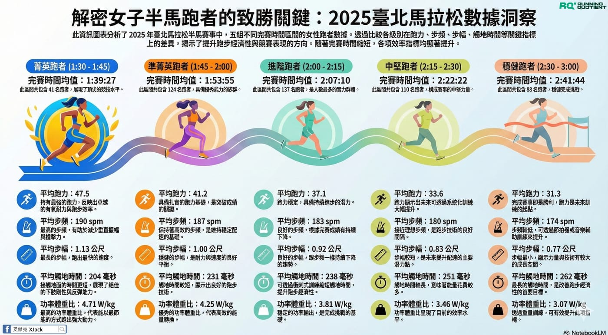

這個問題，其實我自己也很好奇。

所以我把 2025 臺北馬拉松Taipei Marathon  半馬的女性跑者數據拉出來看了一下，共 502 人（其中 1:30 內只有 2 位，樣本太少，先移除不討論），再拿相同完賽區間的男性跑者一起對照，結果出現三個蠻有意思、而且對訓練很有啟發的差異，分享給大家參考。

1️⃣ 女生天生就是「高步頻」自帶者

我們常聽到「步頻 180 是個理想值」，但這組數據告訴我一件事：

女生幾乎是內建這個技能。

在這次半馬數據中，不論落在哪個完賽時間區間，女生的平均步頻都明顯高於男生。舉一個大家最熟的例子，同樣是半馬跑進 2 小時（1:45–2:00）：

🙋‍♂️ 男生平均步頻：約 178 spm\
🙋‍♀️ 女生平均步頻：約 187 spm

差了快 9 spm，而且這不是特例，是「每一區間都這樣」。

簡單說，男生比較常靠「步幅」（也可能是腿長優勢）在撐速度；女生則更傾向用穩定而高效的高步頻來維持節奏。

如果用遊戲來比喻，男生常常點力量，女生則是敏捷先點滿。

2️⃣ 女生的成績表現，更「穩」

接著我看的是「當前跑力」和「完賽時間」之間的關係。

結果很有趣：

在同一個完賽區間內，女生的跑力標準差普遍比男生小。

這代表什麼？

代表女生在比賽當天的表現，通常更接近她們平時具備的能力，配速執行力好、輸出穩定，比較少看到「前半衝太快、後半直接爆掉」的劇情。

反觀男生……\
數據顯示變異比較大，合理推測是：

● 腎上腺素一上來\
● 看到旁邊有人超車\
● 腦袋說「先跟一下應該還好」

然後就沒有然後了。

3️⃣ 心率面前，人人平等

跑法不同、步頻不同、策略不同，但有一件事非常公平：心臟不會偏心。

數據顯示，在相同完賽時間區間內，男女生的平均心率幾乎沒有差異。

例如在 2:00–2:15 這個區間：

🙋‍♂️ 男生平均心率：約 163 bpm\
🙋‍♀️ 女生平均心率：約 163 bpm

一模一樣。

這代表什麼？

代表女生不是靠「比較不累」在跑，男生也沒有「比較硬」的心臟。大家付出的生理代價其實差不多，差的是怎麼把能量用得更有效率。

結語｜差別不在性別，而在你怎麼用身體跑步

女生的優勢在於節奏感、穩定度與經濟性；男生如果能少一點衝動，多一點執行力，成績往往也會更好看。

所以與其問「男生女生誰比較快」，不如問自己一句：\
👉 我現在的跑法，是不是把我的身體優勢用到最好了？
