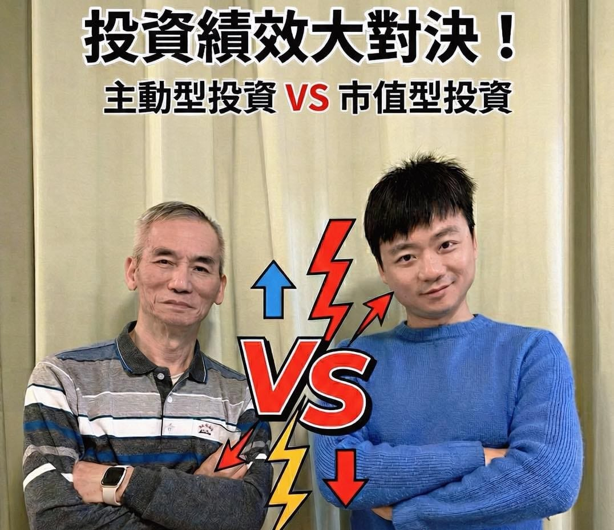

今年元旦 1/1，我跟一個在投資市場打滾多年的人，正式開了一場賭盤。

沒錯，他就是我 72 歲的老爸。

規則很簡單，也很殘酷：\
📆 以台股再創新高的 2026/1/1 當基準點\
📊 每半年結算一次「投資績效」\
⏱️ 一路比到有人服氣為主

我的策略很無聊—\
70% 放 0050、30% 放 VT，不猜高低、不進出、不看盤，含息全部再投入，每年再平衡。

我爸則是完全相反，憑他多年在市場裡的精準眼光，該出手就出手，該閃就閃，是標準的主動投資派。

我跟他說得很直接：\
👉 如果只比一、兩年，我一定輸\
👉 拉長到十年，我的勝率才會上看 80%

所以我拜託他一件事——

好好照顧身體，認真運動，活得夠久。我要讓他親眼看著我，連續贏他二十年。

其實我從小看我爸在股市裡面上上下下，市場一震盪，家裡的氣氛也跟著震盪，這也是為什麼我長大後，一直都很厭惡股票。

直到 2022 年，我第一次接觸虛擬貨幣，丟了 10 萬元進去，結果交易所倒了，直接歸零。

那一刻，我才真的開始「做功課」。

剛好看到大學時期很敬重的學長 Yuki 分享了 清流君 的頻道，我那一週把所有影片全部看完，立刻開戶，把殘存無幾的閒錢 all in 0050，也開始規律定期定額投入。

後來又接觸到 綠角財經筆記 、周冠男 教授，市值型投資的邏輯愈看愈扎實，我才發現，原來投資也可以不用每天提心吊膽，吃飽睡好，躺著領市場平均報酬（是平均，不是平庸）。

我開始跟家人分享這套想法，可惜，目前還沒什麼人願意接受。

沒關係，市場會給答案，時間也是。

這場比賽，我已經準備好慢慢跑了。每隔半年，我會記錄一次，十年後，再回頭看今天這一篇。

到時候，希望我爸還能笑著說一句：

「你，真不愧是我的孩子。」
