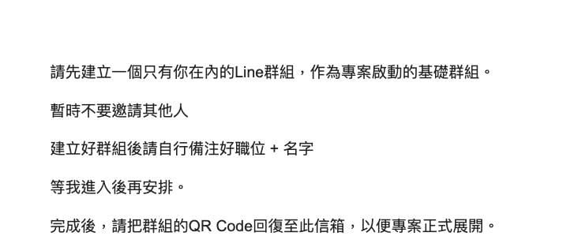

客服同事跑來敲我，語氣看來還蠻認真的：

「老闆，這封信……是真的嗎？這看起來很 AI，但你最近也很 AI，所以我才會問你。」

但幾勒！

我每一篇文章都是跟不同 AI 來回討論很多次，最終的版本也都是我自己完整看過，逐字編修確認沒問題才發的耶！

結果現在判斷依據變成：\
「這很 AI，但老闆你最近也很 AI。」

好，這邏輯我服。

小公司成就解鎖 +1：\
📩 收到詐騙信已經在垃圾信箱，客服還跑來確認
