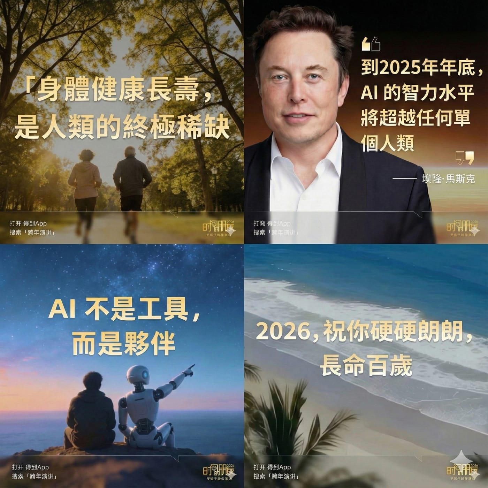

上週聽完羅胖的跨年演講，雖然廣告很多、也沒有什麼大衝擊，但時間都花下去了，還是順手把重點整理了一輪。昨天在 RQ 團隊週會上跟夥伴們分享，也一起整理給這裡的朋友。

AI 接下來可能會改變每個產業的運作方式。

第一個變化最快、影響也最直接的，是醫療。

醫療科技的進步，會明確拉長人類的健康年限。\
只要你願意靠自己好好運動、管理生活，科技的進步，很可能會再「多送你幾年」。

百歲人生，開始變成一件需要被認真對待的事情。

第二個，是我們跟 AI 的關係，真的不一樣了。

一開始，我把 AI 當工具。\
現在，我是把它當成「夥伴」在溝通。

目前我手上的 AI 分工包含：\
● RQ 策略顧問\
● 公司人資主管\
● 叉傑克個人 FB 小編\
● RQ UI / UX 檢查\
● 專業文章審核\
● RQ 客服回信助手\
● RQ 功能規劃\
● RQ 執行長秘書

順帶一提，我已經三個多月沒有自己寫程式了。\
一次叫好幾個 AI 幫我寫、一起 code review。前期學習成本很高，產能一度下降，但現在回頭看，整體開發的細緻度，確實高了不少。

科技越成熟，人與人之間的差距，反而會出現在「健康投入」上。

願意為健康付出的金錢、時間、紀律，差距只會越來越大。

而 RQ 想做的，就是陪著那群：

因為健康、因為低潮，\
甚至因為失戀（誤）而開始跑步，\
跑著跑著，發現跑步其實滿有趣，\
也慢慢學會一次次戰勝過去自己的那群人。

打造給他們，最好用的科學化訓練工具。

今年， RQ 跑力 要邁入第十年。

接下來，我們會更積極把 AI 融進產品。\
也許，現在就是那個時間點。
