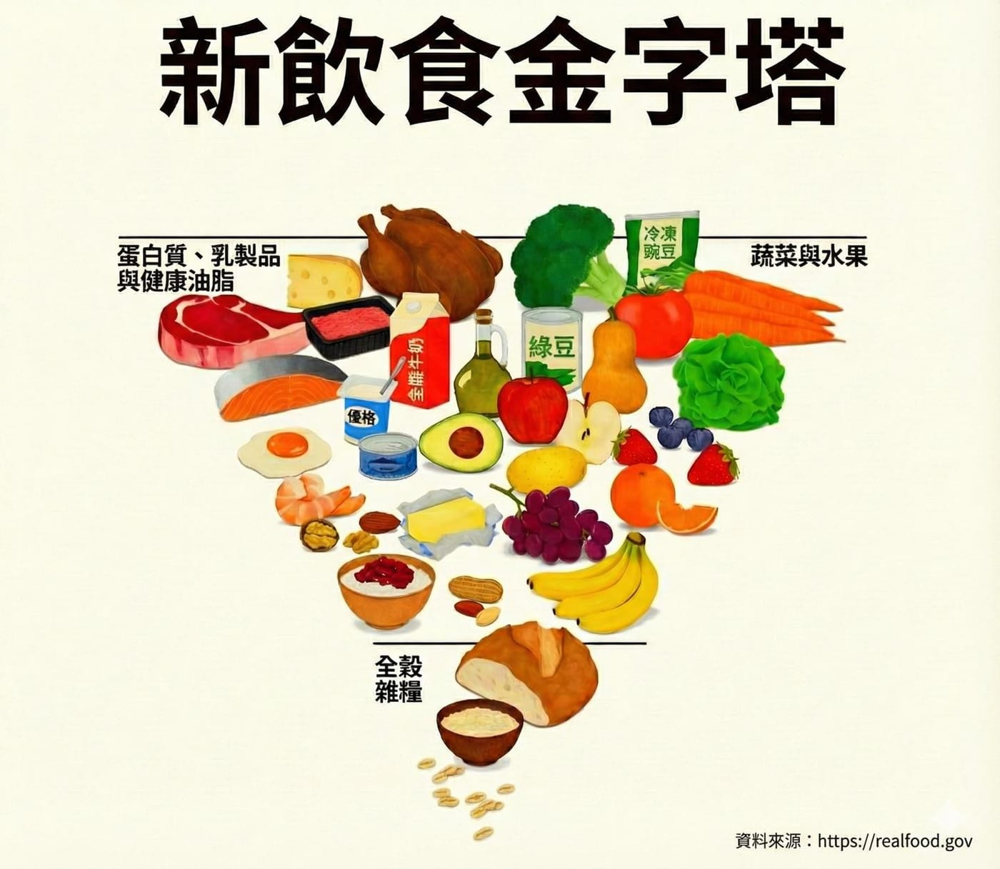

官網其實講得非常清楚：

👉 健康來自於餐盤，而非藥櫃。

這一版飲食指南的重點：\
 1\. 全食物優先（蔬菜、水果、全穀、豆類）\
 2\. 植物性蛋白優先於紅肉\
 3\. 嚴格限制添加糖、鈉與高度加工食品\
 4\. 水是首選飲料\
 5\. 適用於「全生命週期」，包含嬰幼兒

簡單說，就是把真正的食物，放回每天的餐桌上。

⸻

那我們家是怎麼做的？

關於「添加糖」，我們一直有很清楚的界線。

3 歲以前，完全禁止添加糖、零食、餅乾。

也花了很多時間跟長輩溝通，甚至用很直接的比喻：

對幼兒來說，給她吃糖，就像在餵毒品。

（當然，上公幼後在學校破功了；老師用糖果當獎勵，我們完全沒有責怪，這是我們自己的選擇，我們也接受現實。）

現在則有兩個約定：

✅ 每週一次放縱日

👉 當天可吃的添加糖上限 = 體重（kg）× 同等克數（g）\
也可以吃炸物、加工食品，但會控制總量。

✅ 每月一次蛋糕日

用來慶祝節日與生活，不是拿來當日常，就不特別限制了。

我們的原則其實很簡單：

能不吃添加糖、加工食品就不吃。

而且這些規定，是全家一起遵守，不是只針對孩子。

⸻

這次美國最新飲食指南，其實再次驗證了一件事：

吃得簡單、吃得真實，\
比吃得精緻、吃得複雜，更重要。

對了，咖啡因跟冰淇淋目前仍然是嚴格禁止，桐桐也自己答應我們，20 歲以前都不會吃呢！
