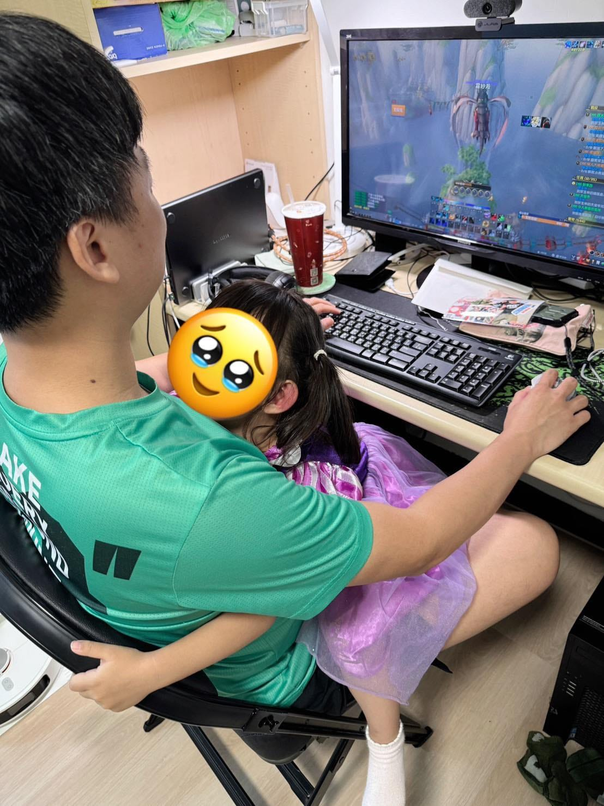

有時候我在工作，桐桐會突然跑過來說：「爸爸陪我玩～」

我會跟她說：「爸爸現在在工作。」\
但我一定會補一句：

「如果你希望爸爸陪你玩，你可以先跟我預約時間喔。」

結果她真的會很認真地跑來跟我說：

「爸爸，我想預約八點，陪我玩 10 分鐘。」

老實說，我很珍惜這件事。

還有一件我一直很刻意在做的事——

我一定不會跟她說：「爸爸是為了你，才這麼辛苦工作。」

因為對小孩來說，如果真的是「為了你」，那現在就應該放下工作，立刻陪她去玩。

所以我跟她說的是另一件事：

「爸爸很喜歡工作，所以現在想把事情做好。」

工作，是我自己選擇的事。\
陪她玩，也是我會好好安排、好好履行的承諾。

我希望她長大後能知道：

大人努力生活，不一定等於犧牲，而是用自己的價值觀，選擇要做的事，並且要去負責。

然後，也願意為重要的人，留下時間。
