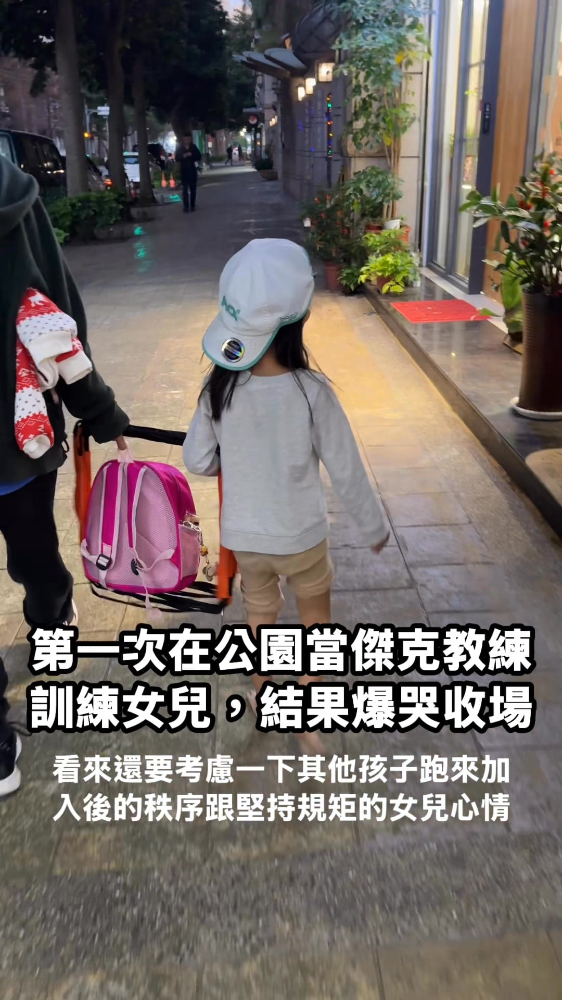

[到 Facebook 看這支影片](https://www.facebook.com/1468991118575441/videos/1406754207646123)

昨天「第一次」帶繩梯去接桐桐放學，正式啟動我腦中規劃很久的——

放學練女兒計畫。

繩梯一攤開、暖身還沒做完，公園小朋友立刻自動集合，一個拉一個跑來問：「我可以一起嗎？」

好，直接升級成多人團練，一起帶操。

進入繩梯訓練後，多數小孩其實都很認真照我教的動作跑，但一定會出現自由創作派，跑一跑開始加戲，順便想接手當教練指揮大家。

接著，排隊秩序開始鬆動。

偏偏最守規矩、最乖排隊的桐桐，在混亂中被誤會插隊。

情緒瞬間爆表，大爆哭。

這時候只好趕快呼叫桐媽支援照顧桐桐，我還是把最後一趟帶完了，才正式下課、回到爸爸模式。

課表完成 ✔️\
控場能力待加強 ✔️\
情緒管理實戰課滿滿 ✔️

第一次當「傑克教練」，就深刻體會到幼兒園老師的強大。帶完一趟繩梯很容易，帶好一群孩子真的需要修行。

這門課，我會繼續練。
