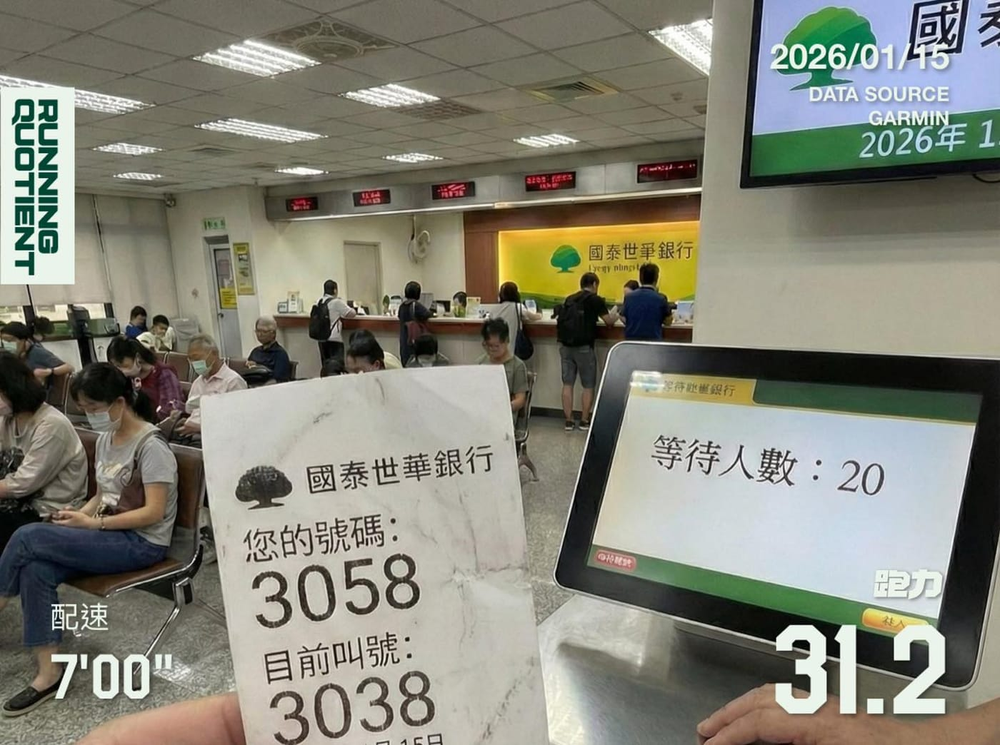

每天跑步也能賺錢！

今天下午去國泰世華銀行辦事情。一進門，看了一下螢幕，等待人數十幾個，覺得這段時間不能浪費。

抽完號碼牌，順口問櫃檯還要多久。

行員說：「大概二、三十分鐘喔。」

我想了一下回她：「那我先出去跑一圈再回來好了。」

她愣了一下：「你要跑去哪？前面可能跳號就會到你耶。」

我說：「我就在這棟大樓外面繞圈圈，快到我再回來。」

她補一句：「喔～我看你就一臉跑很快的樣子。」

哎唷，這麼會講話，怪不得能站服務台！

啊，最近家人介紹國泰人壽的「健康吧」，每天走路累積 7,500 步換 50 點，累積 5,000 點就能換 50 元，算一算每天大概 0.5 元呢。

後來我跑了三圈，看到只剩 2 號，就先暫停回來，然後這 2 號…

又讓我等了 30 分鐘。（倒）
