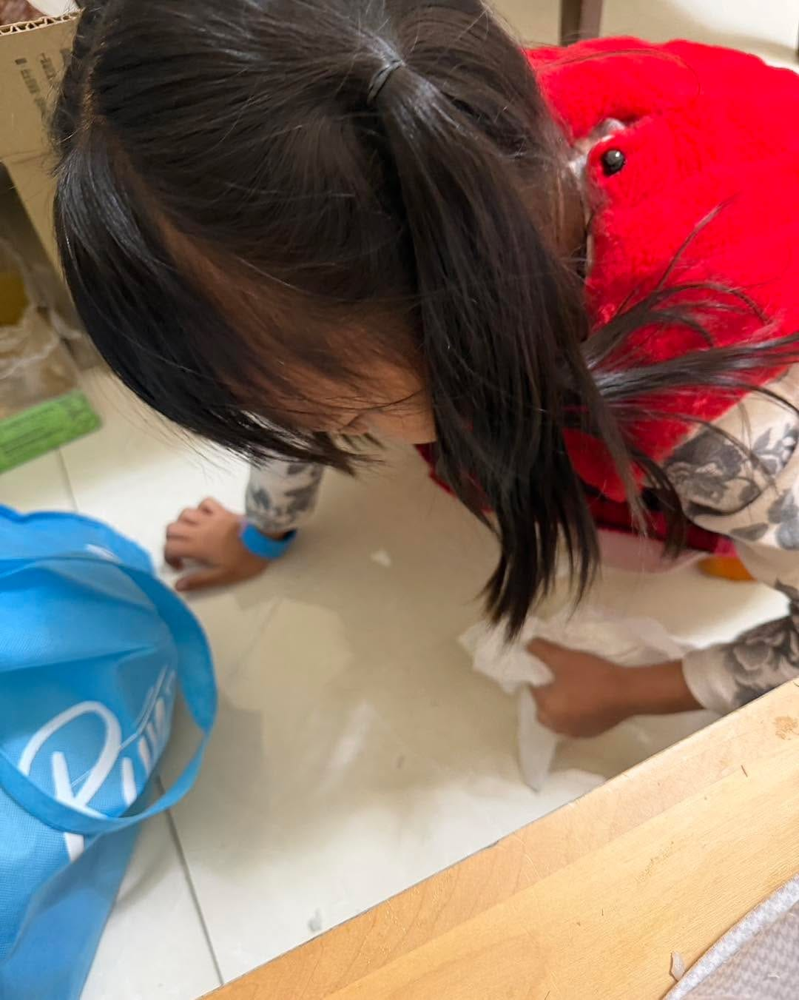

正向教養的力量，\
有時候不是發生在你刻意教她的時候。

桐桐剛剛其實是興高采烈的，端著碗，想拿去房間給媽媽看，一邊走一邊講個不停。

結果在房間一個轉身，飯就這樣拋出去散了一地。

現場很安靜。

沒有尖叫聲，也沒有出現那句很容易脫口而出的「你怎麼那麼不小心」。

我還在想要怎麼開口，她已經自己站起來，拿衛生紙、撿飯、擦地板。

沒有哭，沒有卡住，也沒有先確認大人的表情。

就是很自然地處理一件「剛剛發生的小意外」。

那一刻我突然發現，我們家的日常，好像默默教會她一件很重要的事：

事情發生了，不用慌。\
先把它處理好，就好。
