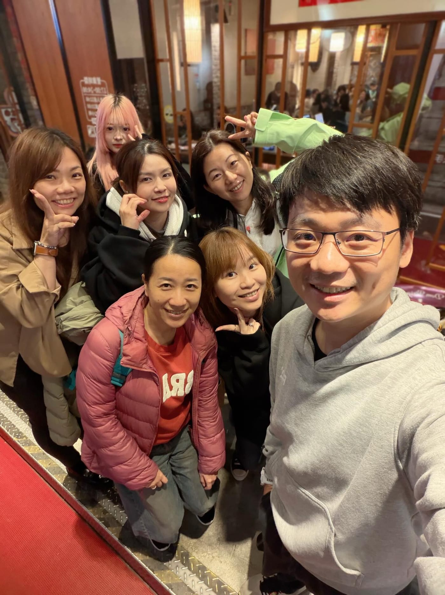

有些跑步緣分，真的不會散。

十年前，在 PTT 上看到有人發起「彩虹橋晨跑團」，第一個反應就是：離家裡這麼近，不去跑一下說不過去吧。

就這樣，跟著一群人一起天還沒亮就出門跑步，來來去去認識不少跑者。

後來幾年，我搬家、離開台北，生活軌跡整個換了一輪，跑步也換了不同的樣子。

沒想到，十年後還能再約出來，坐在同一桌聊天聊地，彷彿中間這十年只是被快轉過去。

跑步很神奇的地方就在這裡，讓你認識完全不同領域的人：有超級拼命日商業務、剛完成巨大案的金融圈人士、為了追星學韓文的會計、超視覺系妹妹、跑步 APP 執行長等。

當下只是一起跑過幾段路，卻在很久以後，還能自然地再坐下來，繼續聊生活。

有些團，有些人，有些晨跑的記憶，真的會陪你跑很久。
