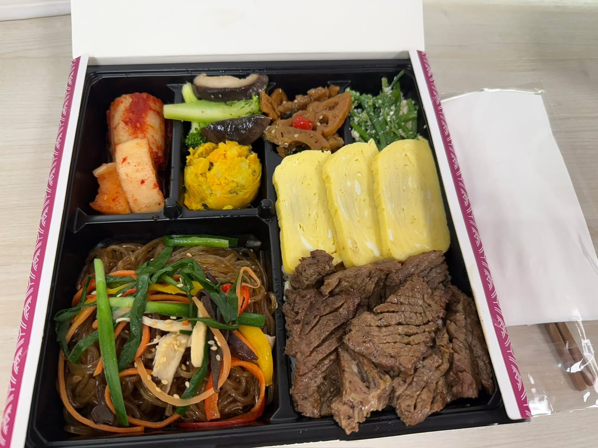

去年我參加過一場 CEO 進化研討會，有個做法我一直記到現在。

那位講師說，他每次開會前一定會先 check-in，而且一定會問一個「沒有對錯、沒有壓力、每個人都能回答」的開放式問題。

目的只有一個：

👉 先讓人進到「人」的狀態，再進到「工作的狀態」。

我覺得這件事非常好，所以後來也把這個做法，直接搬進我們團隊的每週視訊會議裡。

今天我特別準備了一個超級簡單的問題：

「你今天午餐吃什麼？」

老實說，我原本是打算小小炫耀一下的。畢竟平常我老婆都會自己煮午餐給我吃，我甚至還想說要不要順便拍個照。

結果不知道為什麼，今天她直接去幫我買了一個便當。

人生就是這樣，你以為要秀一波，最後只剩下誠實回答問題的份。（倒

分享近十次週會的問題：\
1\. 用一句話，對 2026 年的自己說一個「不完美但很真實」的期望\
2\. 最近一次讓你默默覺得「住在台灣其實滿幸福的」瞬間是什麼？\
3\.  最近你最想推薦給大家的一個小店／小品牌／小景點是什麼？臺灣限定\
4\. 如果你可以把任意一家店瞬間複製到你家附近，你會選哪一家？\
5\. 你最想體驗的極限運動或冒險活動是什麼？\
6\. 如果可以瞬間傳送到世界任何一個城市，你想去哪裡？\
7\. 如果可以立即學會一項新技能，你會選什麼？\
8\. 你覺得 AI 有幫你省下「時間」的具體事情是什麼？\
9\. 如果可以和任何一位歷史/虛構人物共進午餐，你會選誰？想聊什麼？\
10\. 你最想帶 RQ 團隊去辦實體聚餐的地點是哪裡？

附圖是我這輩子吃過最貴的便當，是去參加 OpenAI x AppWorks 的 AI Founder Day的午餐，我拍照給老婆，她立刻查價格給我嚇到。
