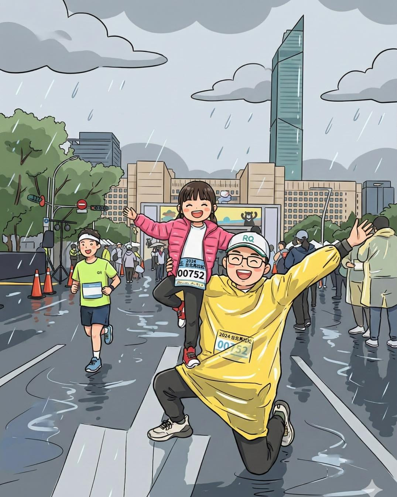

這是我跟桐桐一起參加臺北市政府元旦路跑 3K 的照片。

下雨、地面濕滑、人很多，她跑得很開心，我也跑得很忙。

忙什麼？

忙著觀察她的呼吸、步伐、表情，還有她什麼時候需要停下來。

我訓練孩子的核心理念其實很簡單：

要好玩，要有趣，要多元。

小孩參加路跑，本來就不該是「完成距離」或「拚成績」。

真正該練的，是大人。

大人要有能力判斷：什麼時候可以跑、什麼時候該走、什麼時候該停。

更重要的是—

當孩子跑不動的時候，你能不能直接把她抱起來，讓她好好休息。

孩子只要負責玩、負責開心、負責留下「運動是快樂的」記憶就好。

真正要訓練的是爸媽的體力、判斷力，還有那顆不急、不逼、不比較的心。

我們幫桐桐設定的比賽距離，一直都很清楚，就是 3 公里就好。夠參與、夠體驗、夠留下回憶，也不會把運動變成壓力或風險。

下一場，已經報名好 3/15 的公主路跑。

一樣的原則，一樣的目標。跑不動就停，累了就抱，開心最重要。
