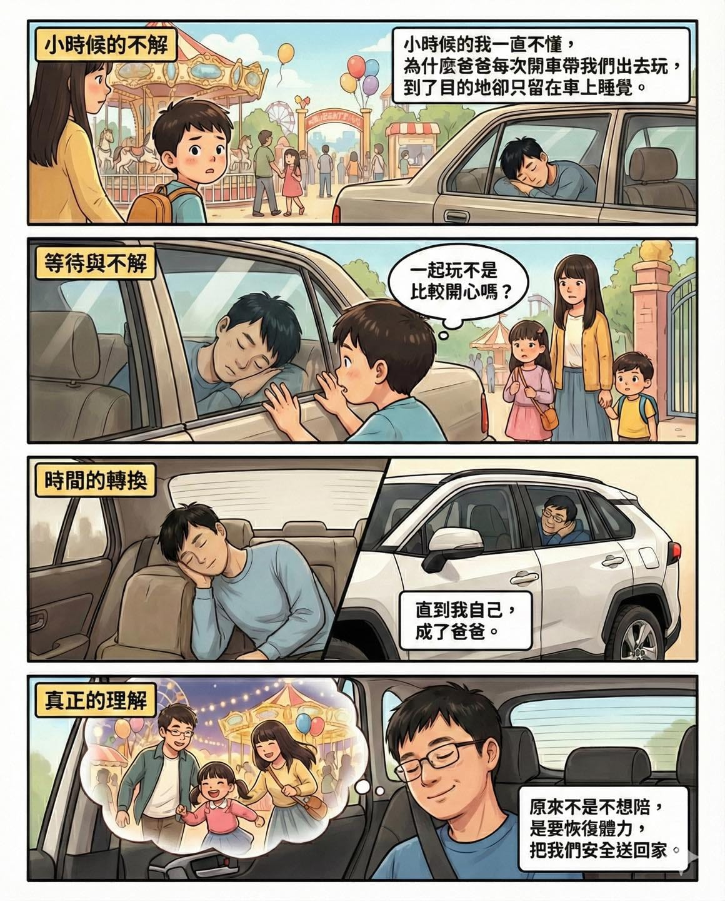

小時候的我一直不懂，為什麼爸爸每次開車帶我們出門玩，到了目的地，卻選擇留在車上睡覺。

遊樂園就在眼前，我們在外面跑、笑、玩得滿身是汗，他卻把椅背放倒，閉上眼睛。

那時候只覺得困惑，甚至有點失落。

畢竟在我心裡，「一起玩」才叫陪伴。

我們家從小就在傳統菜市場討生活，賣鹽水雞、賣小菜。

凌晨三點，爸爸就得起床去市場補貨；回到家立刻開始煮雞、備料、切菜，一路忙到早上六點，攤子一開就一路賣到中午。

我從小就在那個環境長大，也因此自嘲自己是「雞肉王子」。

那些難得的出遊，對他來說，其實是把休息硬擠進行程裡的一小段空白。

直到現在，換我當爸爸。

帶著老婆跟小孩出門玩，看著她們在外面跑、笑、拍照、留下回憶，而我卻常常回到車上，只想安靜地睡一下。

雖然很想陪她們玩，但是我很清楚，接下來還有一段回家的路。

那一段路，需要清醒的判斷、穩定的體力，還有把全家安全送回家的責任。

那一刻我才真的懂了。

原來爸爸當年犧牲的，是跟我們一起玩的時間；換來的，是能把一家人平安載回家的體力。

有些事情，真的要站到同一個位置，才會明白它的決定。

好啦！

就是我在出遊前臨時工作到太晚沒睡飽啦～
