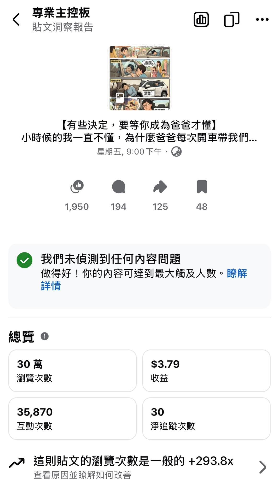

祖克柏，我真的不懂你啊。

這篇爸爸回憶錄，30 萬瀏覽、3.5 萬互動、分享破百，最後分到 3 美金多。

然後另一篇寫特斯拉的，8 萬瀏覽，收益卻是這篇的快 3 倍。

親情、反思、成長、那些當爸爸之後才懂的瞬間，平台的反應大概是：「嗯，很感人，但不太好變現。」

電動車、股票、資本市場、未來趨勢，平台馬上回你：「這個可以，來，多給你一點。」

但沒關係啦，我本來就不是為了分潤才寫這些文。

能看到更多人願意停下來、留言、分享自己的故事，那個數字，才是我真正會放在心裡的 KPI。

至於你怎麼算錢的，祖克柏，我還是選擇繼續不懂 😌
