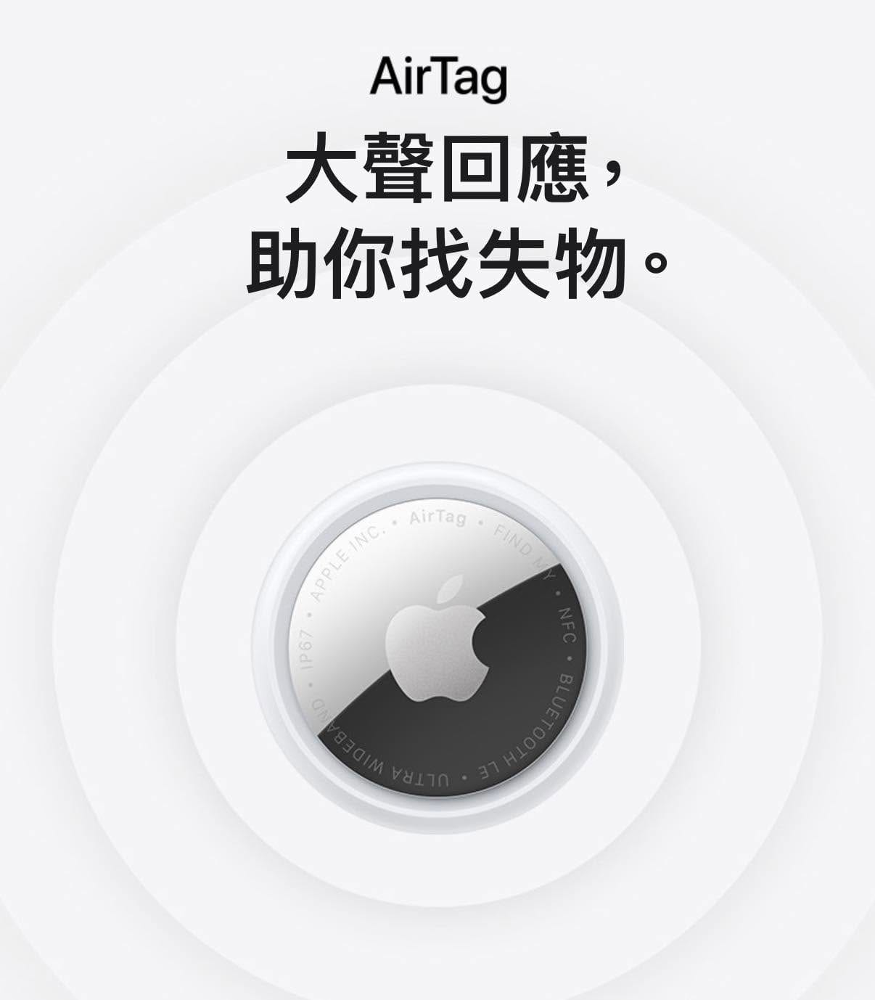

我們一家出去玩的時候，有一個固定流程：手機、錢包、鑰匙，然後是桐桐的 AirTag。

我們替她準備了一個手錶環，直接戴在手上。

現在這個年紀，還沒打算買 GPS 手錶，但「走散風險」是真實存在的，大人全部都是 iPhone，AirTag 很自然就成為一個剛剛好的選擇。

它不會即時回傳移動軌跡，也不會 24 小時定位，但在商場、景點、人多的地方，只要附近有 Apple 裝置，至少可以追蹤她的位置。

對爸媽來說，這個差很多。

最近看到 AirTag 2 即將在台灣開賣，還能客製化刻字，老實說我有點心動。定位距離更遠、精確尋找更穩定、聲音也更大聲！

對我們這種「還不想買 GPS 手錶，但又希望多一點安心感」的家庭來說，真的很剛好。

科技沒有辦法幫你顧好小孩，但它可以在你分神的那幾秒，幫你留下一條線索。

或許這樣，就夠了。
