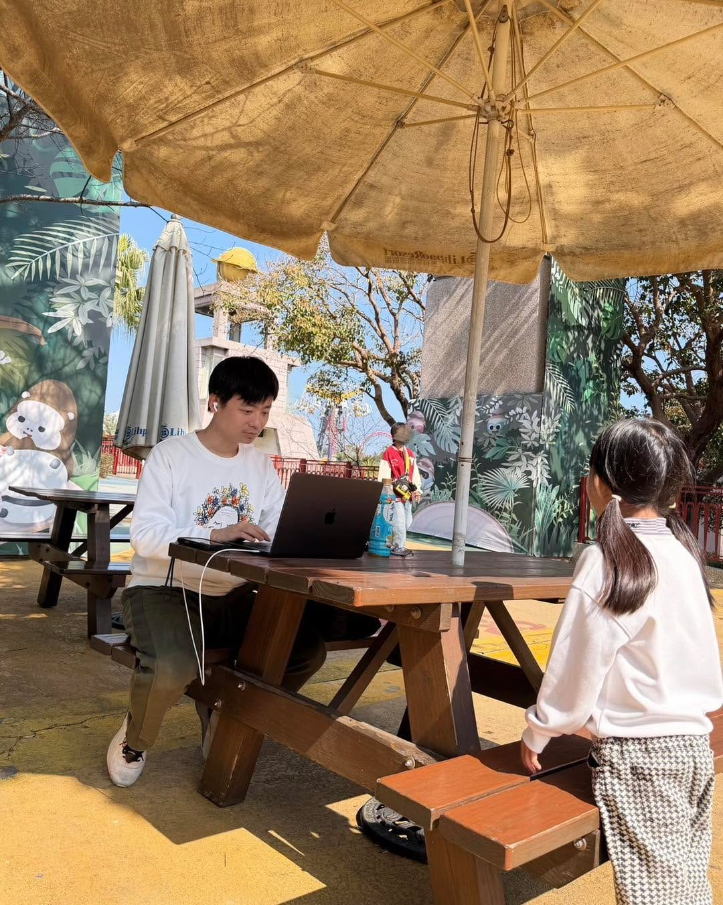

終於有空回顧一下上週的家庭旅行。

這趟麗寶樂園之旅，對我來說，比較像是把工作桌整組搬進樂園裡。

旅遊偏偏又連續遇到幾個緊急事件，只好立刻切進工作模式，安排處理、同步溝通。一張野餐桌、一把遮陽傘、一台筆電，我就在園區裡坐了一整天。

結果意外變成一個「家庭據點」。

家人玩到一半路過，會順便回報即時戰況：

「我們剛剛玩的那個會噴到全身濕。」

「從摩天輪上看得到你耶！」

「你的口香糖再給我幾個。」

我繼續敲鍵盤，他們繼續玩。工作跟生活沒有刻意切開，但也沒有互相干擾。

創業者的日常，大概就是這樣吧。

不在辦公室，事情一樣在推進；人在樂園裡，該處理的決策也一樣要下。

工作跟生活的平衡，本來就沒有標準答案。小孩子的成長只有一次，而有一位我很崇拜的經理人曾經對我說過一句話：

「市場的成長，也有可能就這一次。」
