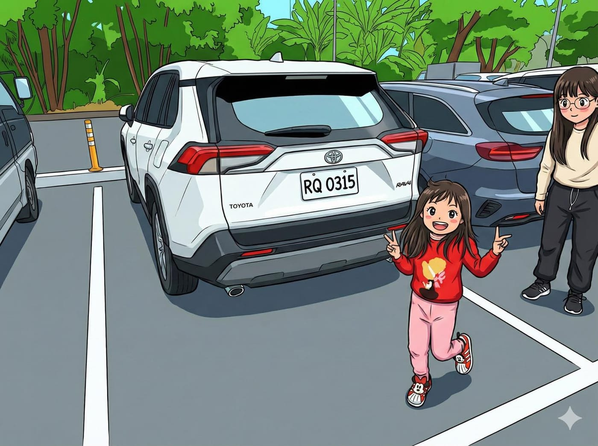

我一直有個固定習慣，只要停好車，就拍一張照片。

一來可以記錄停車地點，二來順便確認當下狀態。如果之後多了刮痕、凹痕，至少心裡有底，知道是不是自己造成的。

畢竟這台車，沒有哨兵模式。

直到那一天，載著桐桐最愛的胖姨出去玩，我照流程停好車、拿起手機、準備「狀態存檔」。

畫面還沒對好，胖姨直接衝進鏡頭內，比了一個超標準、毫不猶豫的 Ya ✌️。

結果從那天開始，每次我對著車子舉起手機，就會自動觸發一個小屁孩事件。

衝出來、站好位、比 Ya，還可以笑到不行。流程熟練到彷彿已經寫進 SOP。

現在我手機裡的停車存證照，已經全面升級成「親子互動紀錄」。

沒有哨兵模式沒關係，至少人生多了一個會主動入鏡的彩蛋。
