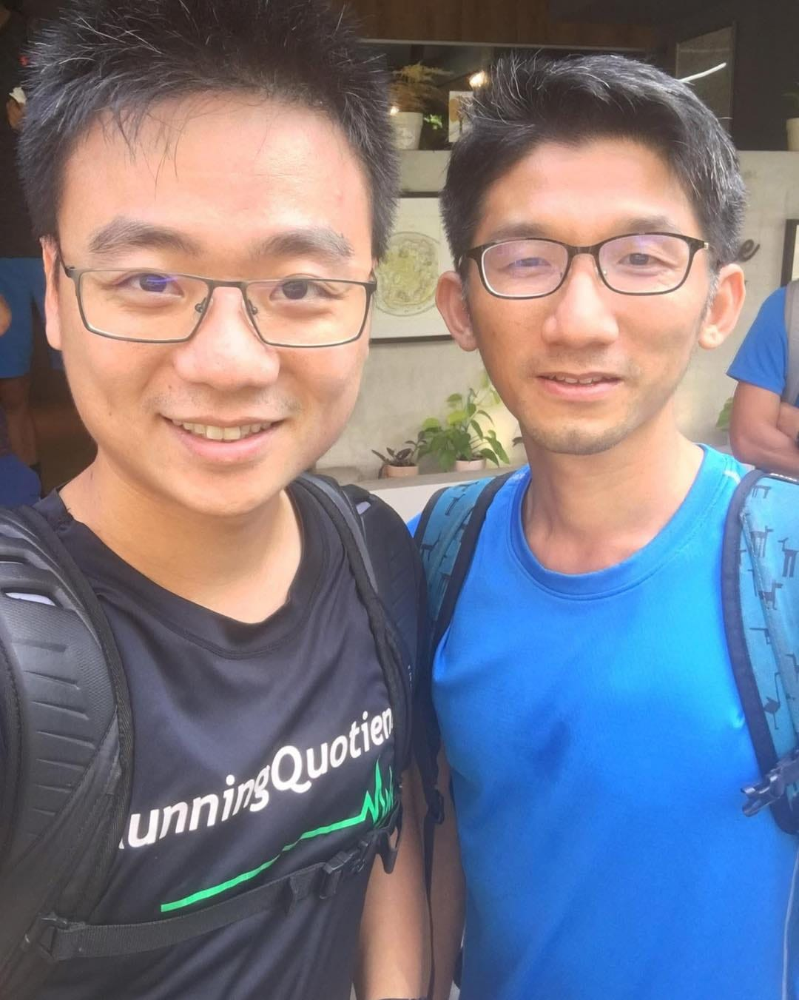

剛剛看到詹鈞智 aka 阿智教練發文。在五十歲這個時間點，他自己一個人，開了一個 Podcast，叫《42.195 公里的夢想追逐》。

故事其實要從東京馬拉松說起。

去年，他看到 MasterCard 與台北富邦銀行合作的活動，只要刷卡達標，就有機會參與東京馬拉松徵選。

他很快達標完成報名，也準備好去面試，結果卻是書面資料第一關就被刷掉了。

那一刻，他很清楚地感受到一件事：

曾經引以為傲的「馬拉松作家」身分，在這個時代，影響力已經不如從前了。

一本書的重量，可能還比不上一個穩定經營的社群帳號，時代真的變了。

他沒有選擇退場，而是乾脆換一條跑道。既然大家不看書了，那就用聲音，繼續講馬拉松的故事。

於是，《42.195 公里的夢想追逐》誕生了。

節目裡，他聊歷史、聊賽事的演進、聊科技怎麼改變跑步，不急著教你破三，只是慢慢把「為什麼我們會想一直跑」這件事說清楚。

但其實，這個人，早就深深影響過我一次。

我現在的臉書裡，有一個秘密相簿，叫做 「火車站跑步環台計畫」。

裡面只有這一張照片：我跟阿智教練的合照。

那是一個被人生暫停的夢。

當初正是因為聽到他在時間非常有限的情況下，利用每個假日，用「火車站接力」的方式，一站一站跑，花了很長的一段時間，才把台灣完整跑完一圈。

沒有炫耀，沒有打卡。

你一聽就知道，這個人是真的把跑步，當成一段人生在走。

我那時候立刻決定，有一天，我也要這樣跑一次！

所以計畫想好了，相簿也開了，名字也取了，甚至想好等半馬練到 105分內就正式啟動。

然後，人生直接幫我轉換賽道，結婚了，小朋友也出生了。想要追火車站，變成追幼兒園下課時間。

計畫只能被生活先收起來。

也因為這樣，當我看到阿智在五十歲，選擇再為自己的人生多開一條賽道，我真的被狠狠提醒了一次。

《42.195 公里的夢想追逐》現在已經在 Apple Podcast、Spotify 上線，設定週更。未來會長成什麼樣，他自己也不知道，但他已經先跑出去了。

而那個「火車站跑步環台計畫」，總有一天，我會把它再打開的。
