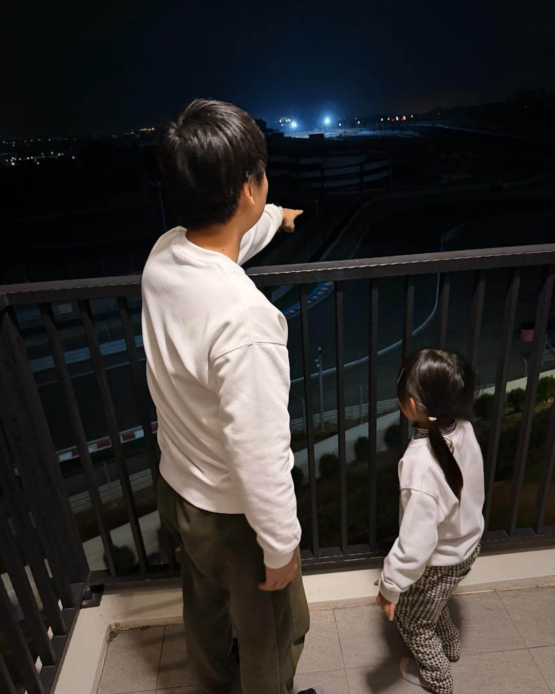

今年 2 月只有 28 天，還剛好撞上農曆過年，攤開行事曆一算，真正能上班的日子只有 14 天。

以前領月薪的時候，看到二月腦中只會浮現一句話：

「少上班天就是爽。」

現在坐在老闆這個位置，第一個跳出來的念頭卻變成：

「這個月現金流又要特別注意了。」

薪水要照發、成本不會放假，但時間直接被砍掉一半。

每月在算的都是公司能不能再多活久一點，因為腦袋裡還有好多事情想完成。

市場隨時在變，風險控管不能鬆，安全措施一層一層加上去。

當老闆之後，思考方式自然被迫切換，連想抱怨的情緒，都得自己消化。

不過老實說，在這個位置看到的風景，真的很不一樣。
