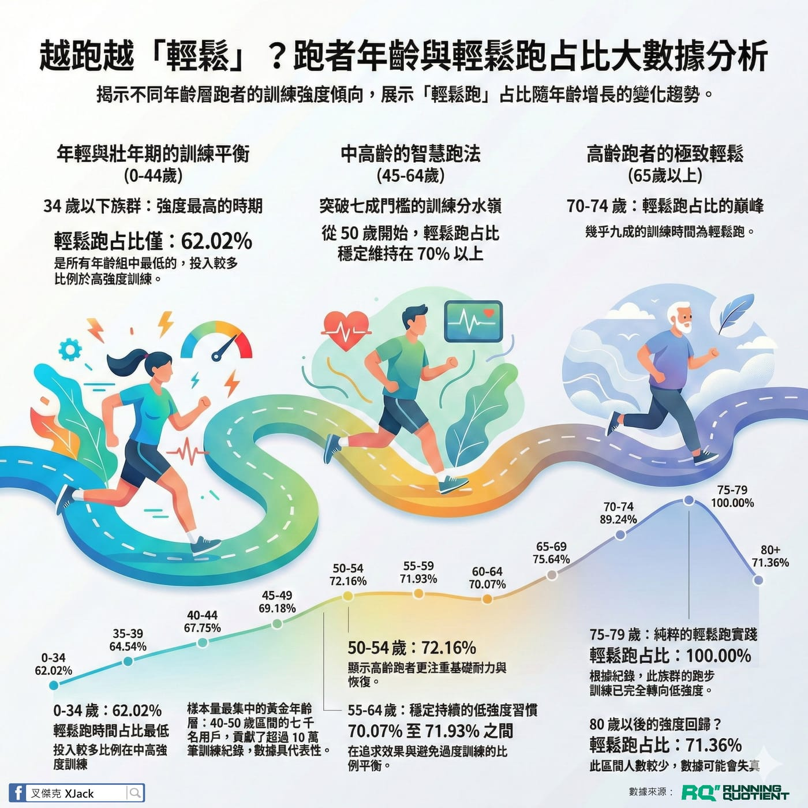

新的行銷夥伴提出要抓一區輕鬆跑的總秒數，我意猶未盡地把 RQ 上所有跑者的 1 月份訓練數據全部拆開來看，結果果然毫不意外。

一句話總結：\
年輕人就是太衝動了，跑得越久，越懂得「慢」的價值。

先說清楚定義，我這裡講的「輕鬆跑」，是指未達儲備心率 74%（第一區間上限）的持續時間。看起來只是慢跑，但這數據背後，我提供了三個有趣的洞察分享。

一、年輕人跑「速度」，資深跑者跑「態度」

0-34 歲的年輕跑者，輕鬆跑佔比只有 62.02%，是所有年齡層裡最低的。年輕氣盛，心率容易跟著配速一起飆高，今天想衝就衝，反正明天又是一尾活龍。

但看看 70-74 歲的前輩們，輕鬆跑佔比直接拉到 89.24%！這不是因為他們跑不動，恰恰相反，能跑到這年紀還在賽道上的，全都是頂級的「控速大師」。他們早就學會一件事：心率控制好，才能跑得久。

年輕人最缺的，正是這份「忍得住不衝」的自律。

二、40-49 歲：扛起半邊天的「黃金世代」

你是 40 幾歲的中年跑者嗎？請給自己掌聲！👏

數據顯示，40-49 歲這個區間約 7,000 位用戶，是人數最多的主力軍。更驚人的是，這群正處於事業與家庭壓力巔峰的跑者，竟然貢獻了全 RQ 最高的訓練時間總量（光是 40-44 歲就跑了 1.6 億秒）。

你們是「最忙碌卻最自律」的一群人，輕鬆跑佔比穩穩維持在 68% 上下，堪稱市民跑者的最強典範。

三、70 歲後的「超級跑者」：每一步都是修煉

雖然 70 歲以上的跑者人數不多，但他們跑的「量」卻嚇死人。

若計算「人均訓練時間」，70-74 歲的前輩平均每人跑的秒數，竟然是 0-34 歲年輕人的兩倍！

這群長者跑步已經不再是為了拼成績，跑步對他們來說是一種生活修行。特別是 75-79 歲的數據中還出現了 100% 的輕鬆跑佔比，展現了運動壽命的極致：跑得長久，比跑得快更重要。

慢下來，才能跑得遠。

年輕時可以拚，但別把所有本錢都在 30 歲前燒光；中年後該穩住，讓輕鬆跑成為訓練主軸；到了老年，能持續站上賽道本身，就已經是一種實力證明。
