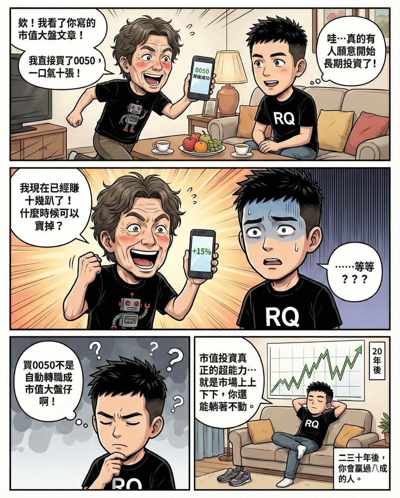

前陣子回老家，親戚跟我說，他看了我寫的「市值大盤」文章後，決定要跟我學習，直接把投資配置改成 0050，一口氣買了十張。

老實說，我當下真的有被感動到。

終於有人因為我寫的內容，願意把時間跟心力，放在真正有長期價值的事情上，而不是每天盯盤，把股市當成大型賭場，跟一堆陌生人拼輸贏。

結果他下一句馬上補了一刀：

「我現在已經賺超過十幾趴了，什麼時候可以賣掉？」

……等等。

我真的完全不是這個流派啊！！！

請不要以為「買了 0050」，就自動轉職成「市值大盤仔」。

市值型投資，重點從來不在於你這一段賺了多少，而是在於你能不能接受一整套新的思維方式：

時間、風險、耐心，全部一起打包重練。

只要你腦袋裡還常出現這些念頭：\
 • 現在是不是該賣了？\
 • 賺這樣算不算夠？\
 • 要不要先落袋為安？

那代表你只是把股市，換成一個比較穩定一點的賭場而已。

我這流派真正困難的地方，就是當市場上上下下的時候，你能不能什麼都不做，繼續躺著耍廢。

投資跟跑步真的很像。

課表寫得再漂亮，你每三天就想改一次，那最後只會越跑越累；照計畫乖乖跑個四個月以上，身體才會給你回饋。

市值投資不會讓你一夜致富，但如果你願意持續投入、慢一點、撐久一點，二、三十年後，你的投資成果，絕對能贏過八成以上的人。

投資上真正的超能力，就是不要太努力。
