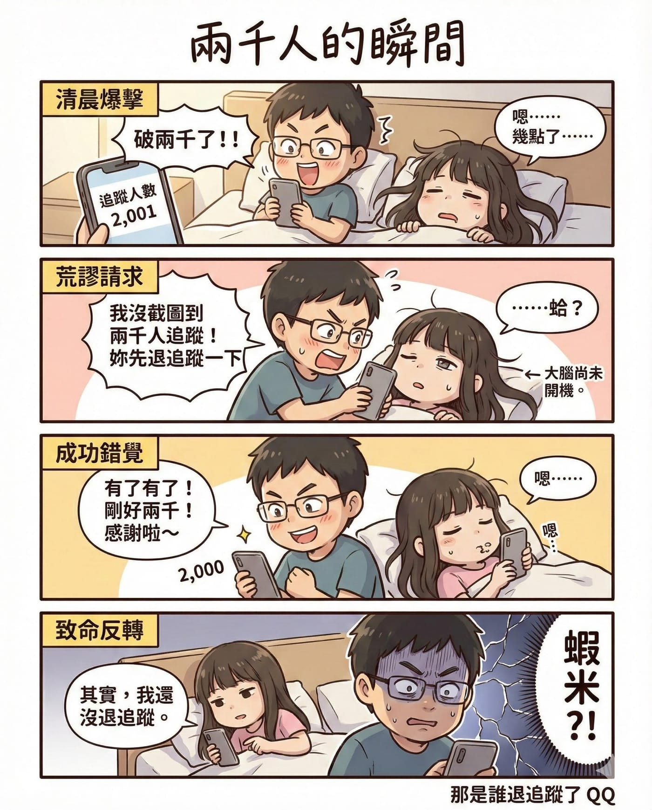

今天一早起床，滑了滑手機，發現我的粉絲團追蹤人數 2,001 人了。

我直接在床上坐起來。

「破兩千了！！」

旁邊還在半夢半醒的老婆被我晃醒，只聽到我激動地說：

「我沒截到圖！妳先退追蹤一下！」

她的眼神，大概只有三成靈魂已經上線。

過了幾秒，追蹤人數變回 2,000 人。

我鬆了一口氣，露出創業者那種完成里程碑的微笑。

心裡還默默想著：

謝謝每一位願意看我碎念跑步、分享生活、講女兒邏輯故事的你們。

然後——

老婆淡淡地補了一句：

「其實，我還沒退追蹤。」

……

我看著手機。

2,000。

那一瞬間，我突然理解了什麼叫做數據的殘酷。在這個世界上，少一個人，真的只需要一秒鐘。

但多一個人，可能是因為某篇文章讓你有共鳴，某個故事讓你笑出來，某段跑步經驗讓你點頭。

兩千這個數字對平台來說很小，對我來說，是兩千位真實的人，願意停下來看我講話的機會。

所以，如果你還看到這裡，真的很感謝你。

至於那位退追蹤的朋友……

我會繼續努力，讓你有一天回來追蹤的 ！😂
