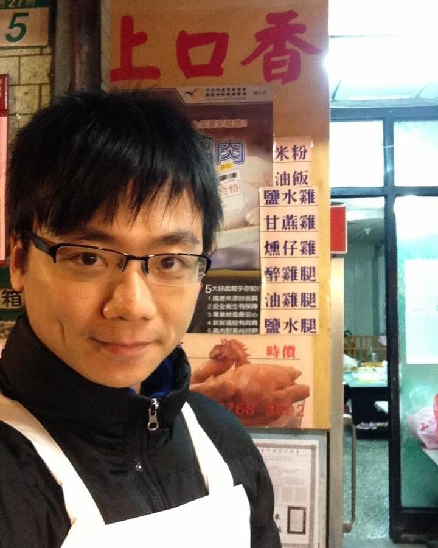

在我爸媽還沒退休以前，他們在傳統菜市場經營一個攤位，名字叫「上口香」。

攤位賣的就是鹽水雞、燻仔雞，還有一整排已處理好的各式小菜。

一年之中，節奏最緊繃的那一天，永遠都是除夕。

那天市場裡的時間像被壓縮過一樣，叫賣聲、鍋蓋聲、腳步聲全都沒停過。

而我，身為被半推半就（ㄅ一）進來幫忙的「雞肉王子」，從小年夜晚上就得先到攤位報到。

一桶一桶雞肉排開來，我得照著時間固定幫每一桶換水，確認狀態，不能少、不能慢。

好幾年寒流來的時候，晚上冷到手指發麻。水一換下去，冷意直接從手心鑽進骨頭裡。

那種時候，外面有沒有在放假、朋友有沒有在玩，我其實也不敢想。

因為我不能離開。

小年夜對我來說，就只是把家裡攤位顧好的夜晚。

一直顧到晚上十點左右，等爸媽起床接手、開始徹夜煮雞，我才能離開。

回家就立刻要洗澡睡覺，大概睡到早上五點，再回攤位開工，一起幫忙賣到中午收攤為止。

因為還得趕在初一早上回南部老家拜拜，凌晨就得從台北開車出發。所以從我有記憶以來，在爸媽退休之前——

我們家，從來沒有一起坐下來吃過一頓年夜飯。

這件事我自己其實早就習以為常，但當時的女朋友（現在的老婆）把這段故事轉述給她媽媽聽之後，她媽媽一想到女兒未來凌晨就要起床煮雞賣雞，心疼到哭了一整個晚上。

那時我才意識到，原來有些成長背景，對旁人來說，是會放在心上的。

附上一張「前雞肉王子」時期的歷史照片。
