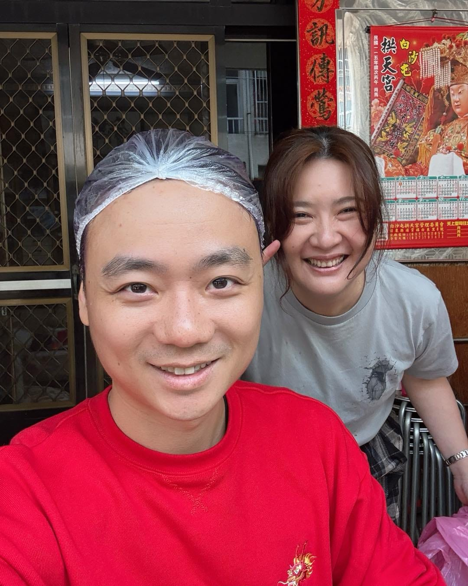

中午團聚吃飯，紅包發完，還上演兩輪紅包加碼賽，現場氣氛堪比最後一趟間歇衝刺。最後桐桐一鏟搜刮所有鈔票，直接獲得最大包加碼。

本來以為流程結束，結果直接解鎖隱藏關卡——染頭毛。

我很有自知之明，第一時間坐上椅子報到。

畢竟如果錯過這一關，下一步很可能是男丁集合，上山挖竹筍。風險評估後，我選擇頂著染劑，等等回電腦前繼續加班。

這次幫我操刀的是舅媽，手法俐落、動作熟練，邊聊天邊完成年度造型升級。真的要好好感謝她，未來幾年的門面，看來都有專屬設計師了。

其實還沒跟老婆結婚前，我每年都陪她回娘家住。岳父甚至幫我在老家弄了一間辦公室，讓我可以一邊過年、一邊寫 RQ。

從優化演算法，到優化髮色，人生版本持續更新中。

祝大家新年快樂，紅包該加碼的，記得果斷出手啊！
