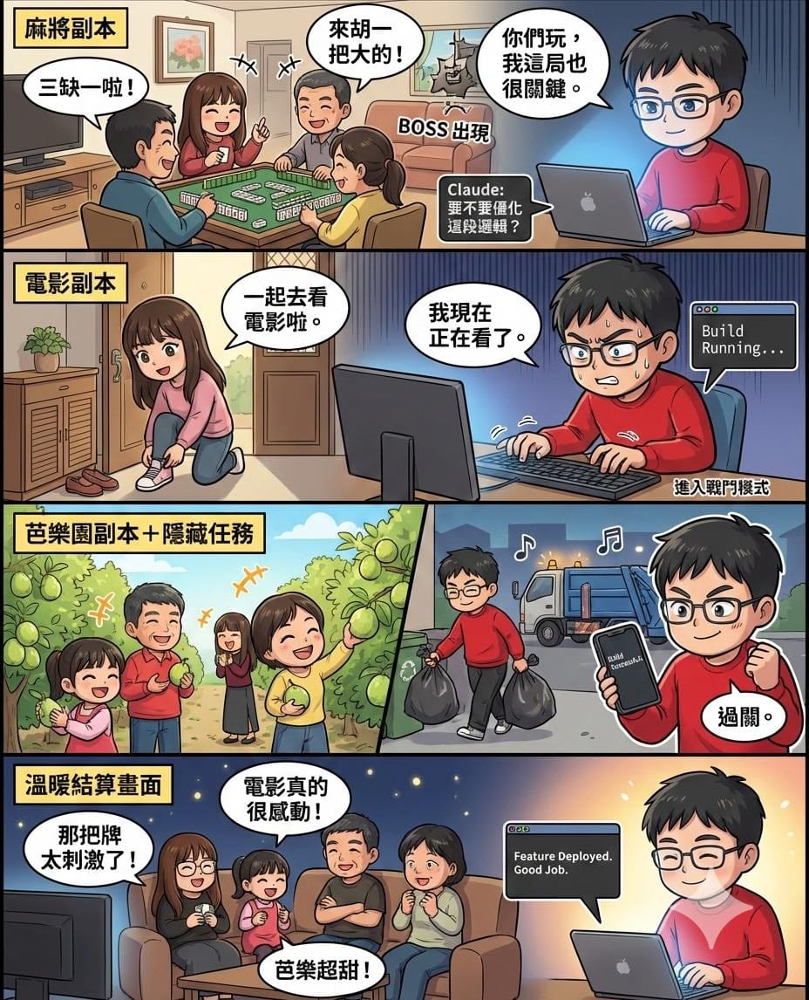

去年 ChatGPT 推出商業版帳號後，我就覺得時機到了。

AI 已經可以正式加入 RQ 跑力 的開發戰隊。我先刷了 codex，開始進入一種新的節奏。

功能我先打底，AI 接著延伸，我再負責整合與優化，直到能安心上線。

幾個小功能來回磨合之後，發現我自己手寫程式的時間，真的越來越少了。

在今年過年前，看到很多人討論 Claude 推的新模型 opus 4.6 很強大。我早就觀望很久，但已經買 3 家 AI 了，遲遲還沒下手，這次工程師的好奇心被點燃，先買 Pro 版本試試看。

結果它的「計畫模式」讓我整個上癮了。

它會先把功能拆解成明確步驟，列出實作策略，確認跟我腦中的架構一致，才開始動手寫。

寫完之後，我再請其他 AI 一起幫忙 code review。

整個流程變成一條完整的開發管線：

需求對齊 → 結構規劃 → 實作 → 檢查 → 優化。

順到一個不行。

然後，額度就用光了。

只好掏出魔法卡，直接升級 Max。沒錯，現代工程師補魔的方式，就是刷卡。

趁著春節連假，沒有會議、不用上課，我一個人專心跟 Claude 推進產品。

九天內更新了 20 多個 PR。

這種高密度迭代的感覺，非常爽！

更意外的是，我真的很享受跟 AI 討論架構與實作細節的過程。

好幾次原本安排要去看電影、出門摘芭樂，最後都選擇留在家裡繼續開發，僅參加必要的聚餐跟活動。

明天正式開學，也正式開工。

時間會重新被切割成工作、研究、家庭三大模組。

接下來的挑戰，是把這三條主線排成一份長期可持續的「週期化課表」。

希望今年，我能把這三種角色跑成一場漂亮的配速策略。

開工大吉，也祝大家新的一年效率升級。🚀
