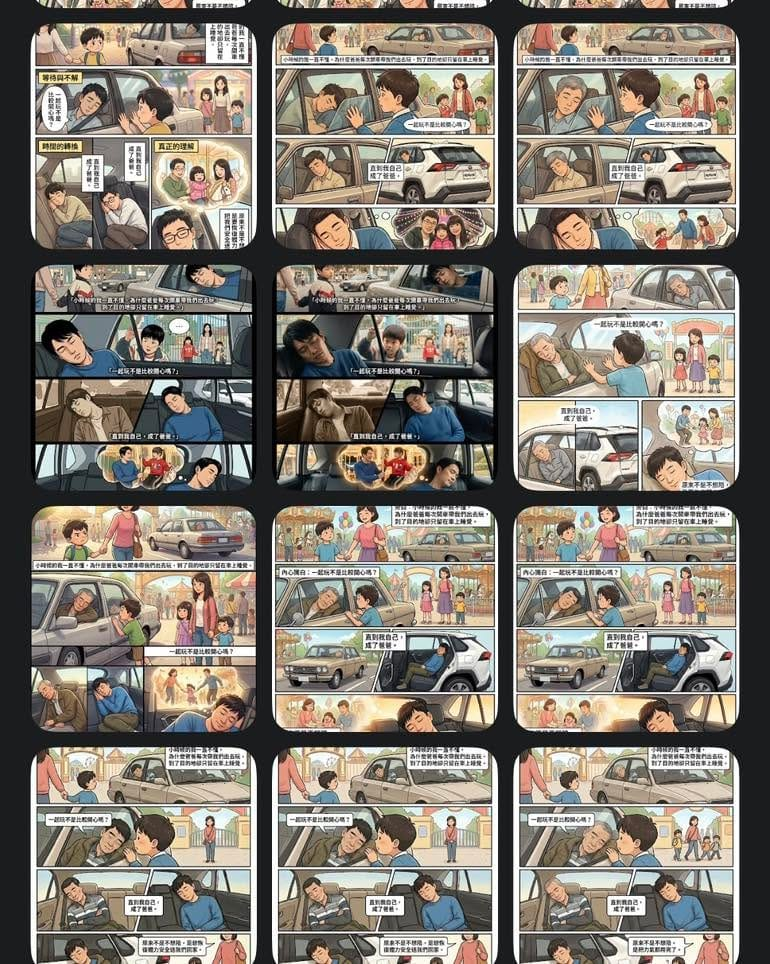

前陣子獲得不少瀏覽的[《等你成為爸爸才懂》](/blog/fb-1363585379116016/)，最後呈現的是 AI 產圖沒錯，但真正花時間的，其實是跟 AI 反覆溝通腳本與構圖。

情緒不對就重來，節奏怪了就重寫。

來來回回改了十幾次腳本，前後產出 30 多張圖片，才終於留下這一張「看了會停一下」的版本。

AI 可以很快，但故事不行。

有些畫面，必須不斷問自己一句話：「這真的是我記憶中的那個瞬間嗎？」

當你腦中浮現的是某個背影、某段對話，或是一種已經說不出口的感覺，那就代表，這張圖有做到它該做的事了。

技術只是工具，留下來的文字，才有機會把回憶傳下去。
