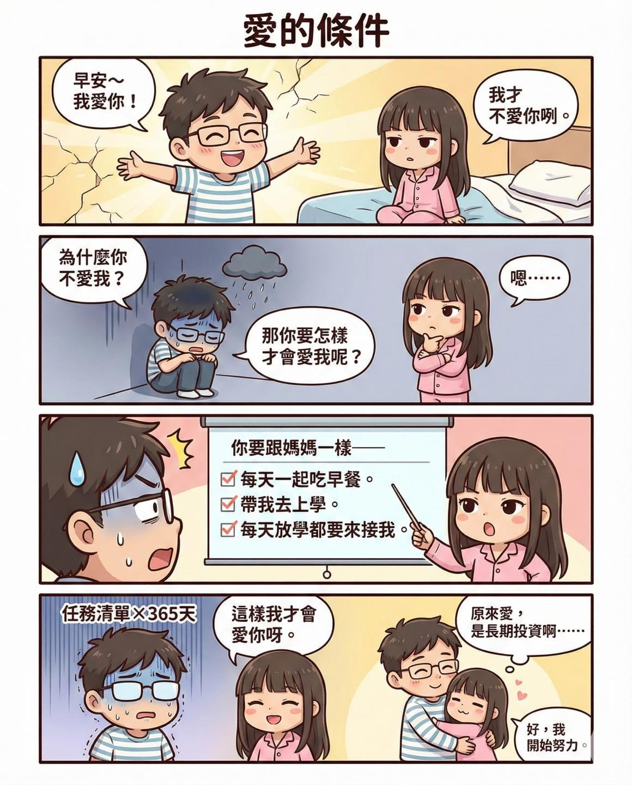

今天早上起床，我很有精神地對女兒說：

「早安～我愛妳！」

結果她看著我回：

「我才不愛你咧。」

我瞬間清醒，忍不住追問她：

「為什麼不愛我？那妳需要怎樣才會愛我呢？」

她想都沒想，直接開條件：

「你要跟媽媽一樣，每天一起吃早餐、帶我去上學、每天放學都要來接我。這樣我才會愛你呀！」

條件明確、頻率清楚、沒有模糊空間。這感覺已經在腦袋裡模擬很多次。

但其實，從她兩歲開始上幼幼班那天起，我跟老婆幾乎每天都一起送她上學、一起接她放學。

早上三個人一起出門，下午三點半時間一到，就自動進入「接送模式」。

那幾年，我真的把「接送桐桐」排進人生最高優先順序。同學家長還偷偷問我們是不是已經財富自由了。

直到她升上大班，我們搬到過個馬路就到幼兒園的地方，我才做了一個決定。

讓老婆固定接送，我把時間拉回公司。

開始更專心打拼事業、推進產品、優化 RQ、思考下一步怎麼走。

因為我心裡還有很多想完成的夢，而陪她成長的這五年，我確實放掉了不少機會。

只是五歲的小孩不會用「事業發展」來衡量愛。

她只用一個指標判斷：

今天誰來接我。

原來在她的世界裡，愛沒有估值，沒有股權，也沒有募資簡報。

愛就是陪伴。

而我現在的人生課題，大概就是怎麼在事業與陪伴之間，找到屬於我們家的最佳配速。

跑步教會我的，是持續累積。\
當爸爸教會我的，是長期在場。

這兩條路，我都還在練。
