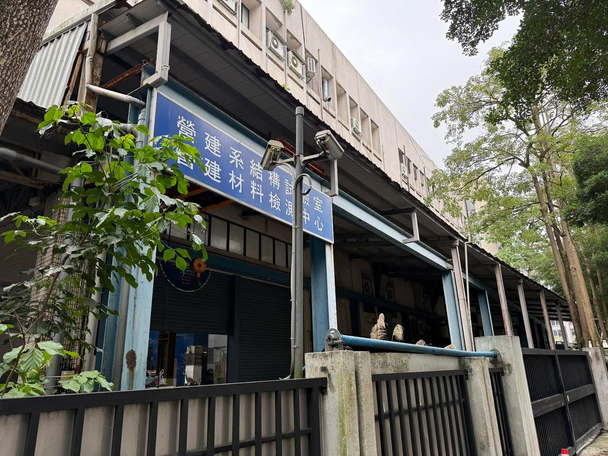

每次來臺科大上課，路上都會經過一棟看起來很像工廠的實驗室。

藍色招牌寫著：

「營建系結構試驗室 / 營建材料檢測中心」。

老實說，我以前一直覺得它看起來酷酷的，但也沒有真的去研究裡面在做什麼。

直到前幾天下課經過時，看到裡面有人在敲敲打打。

那個聲音很不像一般實驗室，反而很像工地。

當下就忍不住想了解，這裡到底是在做什麼研究？

回家之後就去查了一下，才發現這種結構試驗室有一個很有意思的研究核心：

把建築結構做到接近真實尺寸，然後想辦法把它弄壞。

研究人員會用巨大的油壓設備，對混凝土梁柱施加幾十噸甚至上百噸的力量，模擬地震、拉斷鋼筋、壓碎混凝土，觀察結構是怎麼破壞的。

因為只有真正看到「怎麼壞」，工程師才知道未來該怎麼設計得更安全。

所以這些看起來很像鐵皮工廠的地方，其實是研究台灣建築耐震的重要基地。

身為一個寫程式的人，查完之後忽然有一種很熟悉的感覺。

工程很多時候都是同一個邏輯：

先做出一個系統，再不斷測試它的極限，找出它會出問題的地方。

土木工程師用油壓機把柱子壓到破壞；\
網站工程師用流量把伺服器逼到極限。

研究破壞，其實是在理解極限。

我後來想，自己在研究跑步資料這件事，其實也是同一種邏輯——

不斷測試邊界，才知道什麼是真正的極限。

小聲說：桐桐對她媽媽似乎也是在不斷測試邊界呢（誤）
