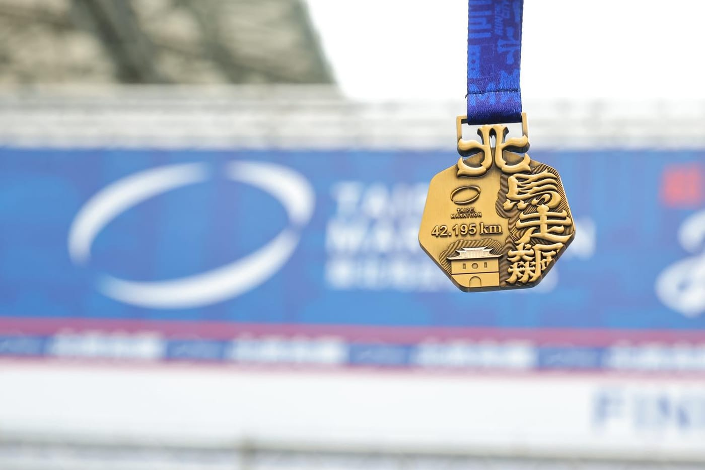

如果你問我，這十年經營 RQ，看到跑者最大的差別是什麼？

我會說，就是「動機」的不同。

心理學常把動機分成兩種：外在動機與內在動機。

外在動機很直覺，為了獎牌、為了 PB、為了體重計上的數字、為了社群貼文按讚數。

內在動機則比較安靜，單純喜歡跑步時風吹在臉上的感覺，喜歡配速穩穩落在節奏裡的專注感，喜歡那種「我今天又比昨天更靠近一點」的感覺。

兩者都可能存在。

但能讓人長期堅持的，往往是後者「內在動機」。

我看過很多跑者，一開始因為「想變瘦」、「想破四」、「想跟朋友一起跑比賽」而開始訓練。

這些都很好。

目標會讓你起跑，但如果訓練的理由只剩下「為了成績」，一旦成績卡關、比賽取消、生活變忙，跑鞋就會默默躺回鞋櫃。

這時候你會發現：

原來自己只是進入另一個「正在上班中」，並沒有真的在享受。

這件事，我在開發 RQ 時也深深體會。

如果我只是為了營收、為了用戶數、為了成長曲線，我絕對撐不到現在。

真正讓我半夜三點還在 debug 的，是那種看到演算法精準解析出數據、看到跑者終於理解自己身體時的爽感。

「欸，這個演算法有準欸！」

「原來訓練可以這麼科學。」

「居然還有這個方法可以優化呢！」

那種單純的好奇心、那種想把事情做得更漂亮的衝動。

這，就是我的內在動機。

或許你會問那是不是就不要獎勵、不要目標？

也不是。

獎牌很好，破 PB 很爽，領薪水當然更重要。

差別在於你把它當成唯一的理由，還是努力之後的附加價值？

當結果成為唯一意義，過程就會變得很沉重。

當你本來就享受過程，結果只會讓這份喜歡更有重量。

我反而覺得生活裡該留一點看似「沒什麼用」的事。

像我打魔獸世界；\
像我老婆開始勾毛線；\
像有些人純粹為了看日出而騎去太麻里。

它們未必帶來實際利益，卻會提醒你：自己還在為喜歡而活。

那種感覺，很珍貴。

如果現在的你，覺得跑步變得有點累、有點像在打卡，或許可以問問自己～

當初讓你開始跑的那個瞬間，是什麼？

也許，答案就在那裡。
