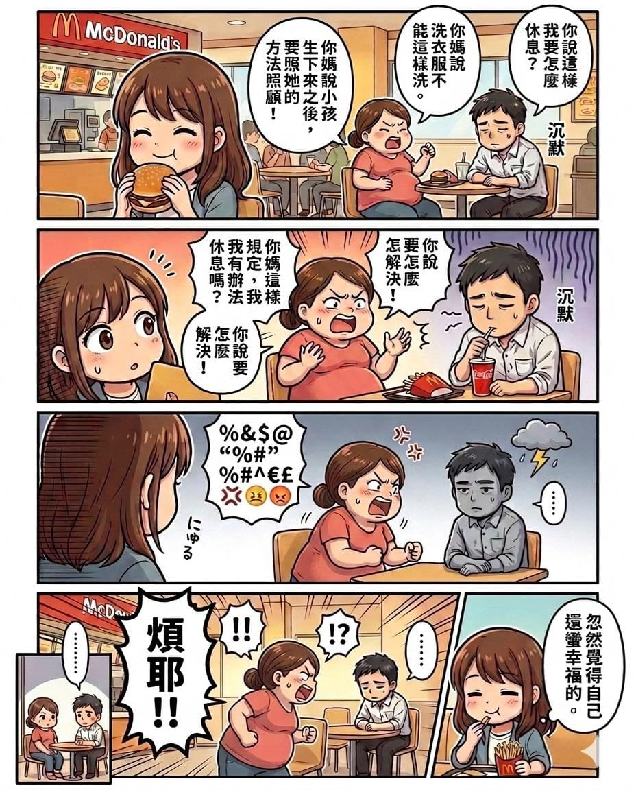

她前幾天跟我分享這件事。

那天中午，她在麥當勞吃東西，旁邊坐著一對夫妻。

老婆看起來大概懷孕七個月左右，情緒很激動，一直很大聲地對老公說：

「你說這樣我要怎麼休息？」\
「你媽說洗衣服不能這樣洗。」\
「小孩生下來之後要照她的方式照顧。」\
「你媽這樣規定，我有辦法休息嗎？」\
「你說要怎麼解決？」

小阿姨忍不住默默轉過去看。

那個男生從頭到尾，只是低著頭，一句話也沒有說。

最後女生突然大喊了一句：

「煩耶！！」

整間店瞬間安靜。

聽完這個故事，心裡其實蠻有感觸的。

每一對準備當爸媽的夫妻，大概都會經歷這樣的時刻。

累、焦慮、不知道怎麼做才是對的。很多情緒，就在某一個普通的下午爆出來。

那不一定是感情不好。

只是兩個人正在學習，怎麼一起變成爸爸媽媽。

我們當年其實也走過很難的一段。

桐桐出生那天，原本是滿滿的喜悅。

結果突然急轉直下。

老婆產後大出血，被緊急送去動手術，我在手術房外等消息，後來又進了加護病房。

那段時間真的很可怕。

但也是那時候，我第一次很清楚地意識到——

原來經歷過生離死別的關頭，  才會真正知道，那個人對你有多重要。

然後有一個小生命，因為你們兩個人，來到了這個世界。

這件事其實很奇妙。

現在家裡有一位五歲的小女孩。

每天吵吵鬧鬧、抱來抱去、媽媽來媽媽去的。

有時候會突然衝過來抱你一下；\
有時候會問出很奇怪的人生問題。

生活變得很吵，但也變得很有趣。

我常常在想，如果當初沒有走上這條路，我的人生會少掉什麼。

那位麥當勞裡的準爸爸，現在大概只想趕快逃出那間店。

但等孩子出生之後，他很快就會知道：

原來人生會有這樣的關卡。

也會有完全不同層次的快樂。
