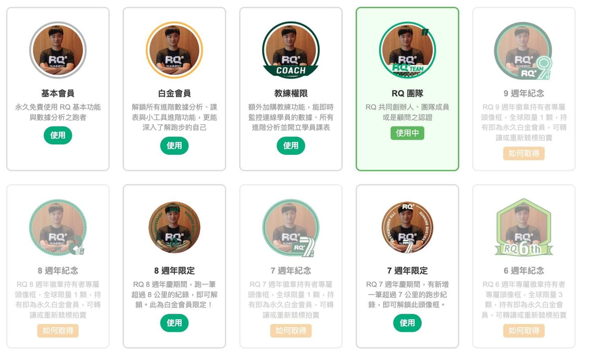

這個功能，我拖了 1,200 天。

三年多前，RQ APP（跑步科學化訓練平台）上線了「頭像框」功能。聽起來很簡單，就是大頭貼外面多一個圈圈。

但我們從一開始就把它做得很認真。

不同會員等級有不同的框。之後每一屆週年慶，還會推出紀念頭像框，透過競標，讓少數人得到專屬資格。

六週年只有三位，七、八、九週年，全球各只有一位持有者。持有即為永久白金會員。

這個框代表的，是你在這個社群走過這段歷史，而且，我們記得。

然後有人問：「網站版什麼時候有？」

這張卡片老早就開在待辦清單裡靜靜躺著。

一想到圖片裁切、Canvas 合成、RWD 等等，每次我都是假裝沒看到。

一躺，就是 1,200 天。

直到上週，我試著用 Claude Code 來做。

不到 24 小時就上線了，包含我睡覺的時間，AI 也在做。

三年的欠債，原來可以一夜還清。

真是舒服😌

RQ 跑力 快 10 歲了。

敬請期待 🎂
