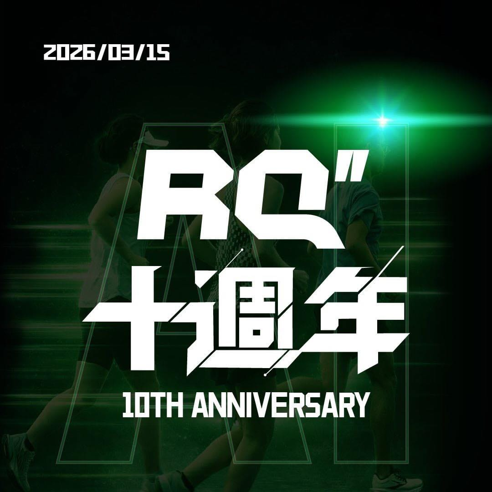

十年前，我只是想幫一位叫徐國峰的鐵人隊教練解決算跑力的問題，沒想到這功能寫成了一家公司。

今天是 RQ 的 10 歲生日。

2016 年的時候，跑錶其實已經可以記錄很多數據了。

配速、心率、步頻、觸地時間、垂直振幅等等。

資料越來越多，但大多數跑者其實只看到一堆數字，而不清楚它代表的意義。

如果這些數據能夠被「翻譯成訓練」，跑者就能更清楚知道自己現在在哪裡、該往哪裡進步。

於是我們開始寫一個工具。

萃取出跑步訓練最基礎的元素，從幫一群鐵人隊成員計算開始，一路優化演算法至今，已經有 10 幾萬跑者使用。

當時只是想把跑步能力用一個更直覺的方式表達出來，沒想到這個小工具，後來慢慢長成了今天的 RQ。

RQ 的核心概念其實很簡單：

把複雜的跑步數據，變成跑者能理解的能力指標。

於是「跑力（RunningQuotient）」誕生了。

跑者可以知道自己現在的能力，教練可以更精準地安排訓練，課表也開始有了科學化的基礎。

接下來的幾年，RQ 一步一步長大。

我們開始和教練合作跑班與訓練營，推出線上一對一教練服務，做了市民跑者培訓計畫，也把跑步功率訓練帶進台灣跑圈。

那幾年其實做了很多事情，但回頭看，最重要的事情反而發生在生活裡。

2020 年，桐桐出生了。

那一年我突然更強烈地感覺到，人的生命很脆弱，健康，其實是人生最重要的資產。

也讓我更確定一件事：

推廣有氧訓練，會是我這輩子的志業。

2021 年疫情來了。

很多實體訓練停擺，但訓練這件事沒有停。

我們和很多教練一起把課程搬到線上，很多跑者第一次發現：原來訓練也可以完全在線上完成。

再後來的幾年，我們做了很多看不見的事情。

系統幾乎整個重寫了一遍，演算法持續優化，穿戴裝置整合也重新整理。

RQ 也慢慢從一個工具，變成一個完整的跑步訓練平台。

2023 年，我們替 RQ 做了一次很重要的改變。

RQ 正式正名為 RQ 跑力，也推出了新的 LOGO。

LOGO 裡加入了象徵時間精度的「角秒符號」，同時確立了品牌標語：

Make Every Second Count

對跑者來說，每一秒的訓練，都在累積未來的能力。

2025 年 9 月，我們開始測試一件事情：

AI 跑步教練。

想像一個畫面。

你跑完一堂課表，手錶剛同步資料，系統就開始分析。

今天的心率、配速、訓練壓力、恢復狀態全部被解讀。

接著 AI 會告訴你今天這堂課的品質，以及接下來幾天該怎麼調整。

背後的邏輯，其實就是這十年我們一直在做的事情——

把數據翻譯成訓練。

而 AI 背後的訓練邏輯，來自徐國峰多年累積的方法論，並持續由教練校準。

而今天，2026 年 3 月 15 日。

RQ 成立滿十年。

我們也正式公開上線 AI 教練的第一個版本。

也就是一開始提到的那位鐵人隊教練 徐國峰 HSU KUO FENG。

回頭看這十年，RQ 從一個小小的數據工具，慢慢變成陪很多跑者一起訓練的平台。

很多功能，其實都是跑者提出來的。

很多方向，也是跑者一起走出來的。

所以 RQ 更像是一段旅程。

而我只是那個一路在寫程式的人。

10 歲了。

如果把 RQ 當作一場馬拉松，我們大概剛過 30 公里。

這十年，有人從 5K 跑到全馬。\
有人第一次站上起跑線。\
也有人陪著 RQ 一起長大。

回頭看才發現，很多故事其實都是從同一個地方開始的。

一個教練、一段程式碼、一群夥伴，還有認真跑步的你。
