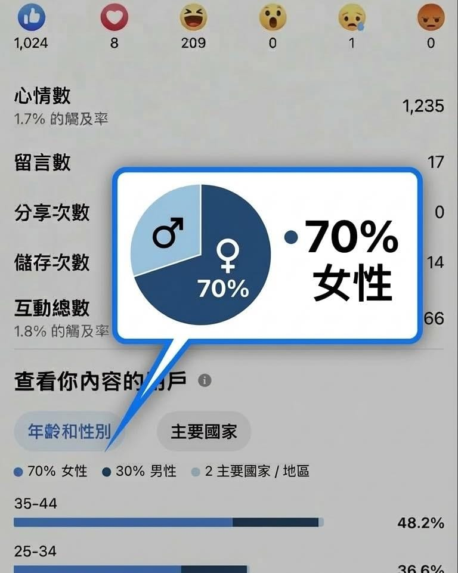

我被這張數據嚇到了。

做產品十年，使用者幾乎都是男生（80%+）。

現在寫文章，變成 70% 女性。

？？？

本來只是想認真寫 100 天，從 12 月一路寫到 3/15 週年慶，剛好收一個段落。

但寫到一半開始發現，有好幾篇桐桐的日常，留言突然整排都是媽媽。

就連我小阿姨都說：

「你寫跑步我完全不想看，但為了桐桐漫畫，只好繼續追蹤。」

那一刻我才確定讀者真的換人了。

有人因為小孩點進來，有人因為生活感留下來，最後才慢慢看到跑步。

100 天寫完了。

接下來，佛系一點也沒關係，但我真的很想知道——

能用文字或漫畫，把多少不跑步的人，看見跑步。
