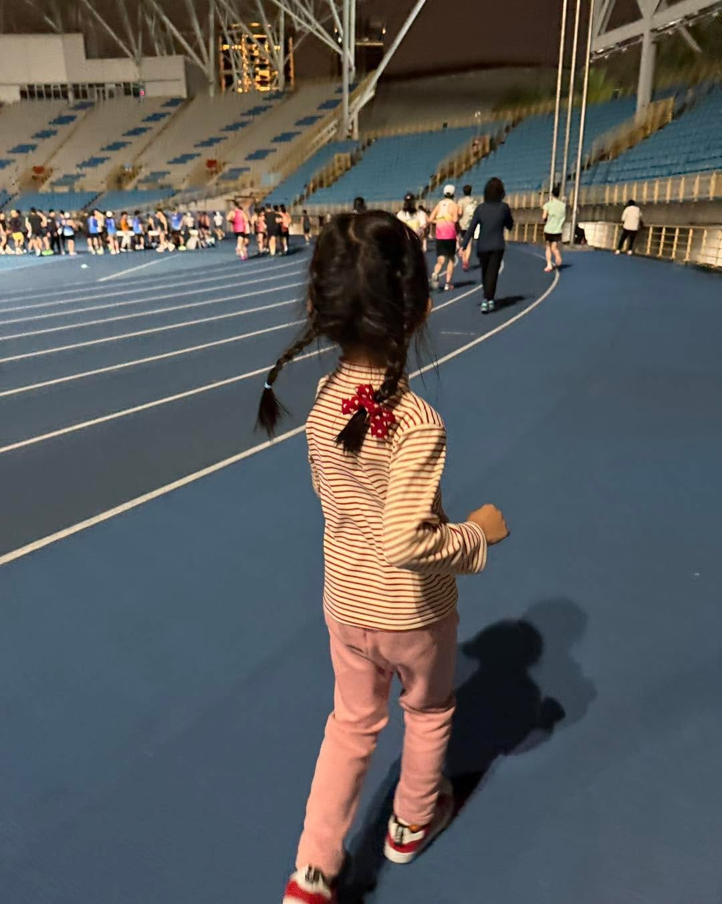

先說答案 —— 與一群人同頻共振。

「同頻共振」太玄？其實就是找一群志同道合的人一起流汗、一起對教練唉唉叫，最後再一起認命把課表吃完。

跑齡多年才體會出這道理，主因是從桐桐出生後，我的生活就在奶爸與 RQ 數據間切換。

在桐桐還沒出生之前，我到處參加各大跑班，玩得不亦樂乎，跑力也相對穩定。當時覺得上跑班如喝水般自然，只管享受。

然而，這5年來，訓練變成斷斷續續的「跳針循環」。每次下定決心打掉重練，課表跑不到幾週，就自動從我的生活中fade out。

直到農曆年前，我回到熟悉的台北田徑場，參加 Coach Hank 陳政翰 教練的動見跑班。才猛然體會到，其實維持規律訓練的關鍵，就是這麼樸實無華 。

【 3B 組的追馬尾筆記 】

我被分在 3B 組（半馬 2:15 等級），這班級分法極細，竟然有 8 組！當天課表是 1600m \* 4 趟，配速 5'50''。久沒練的我，開跑前就在盤算哪一圈要「跳車」。

我跟在兩位女同學後面，全程追著馬尾跑。當我跑得雙腳像灌鉛、呼吸快斷氣時，Hank 教練在場邊盯著每個人的跑姿。讓我不敢掉以輕心，跟到速度同時盡力維持著動作。

他在組間休息幫我微調了身體角度，說也神奇，調整後沉重感減輕了不少！

雖然前兩趟我還是忍不住先跳車，但靠著老鳥同學帶節奏與鼓勵，最後順利完成了課表。

專業引領 + 同儕激勵 = 找回跑步節奏

這公式真的屢試不爽！

【 跑班現場的喇底賽觀察 】

場邊聊天時，我發現同學們進跑班後就「賴著不走」都是有原因的：

 👩🏻‍🦰資深學員 Iring跑齡兩年半，曾飽受一跑就「很喘」的困擾。教練透過一對一的調整，精準抓到了她的問題點。現在的她，半馬成績已從兩年多前的 2:30 進步到 1:52。

Iring分享，因為教練能對症下藥，解決細微的疑難雜症，才讓訓練穩穩進步。持續參與跑班，也讓她無論冬夏都能維持規律訓練，更發現「夏天規律練，冬天真的能表現更穩、更好！」

 👱🏻‍♀️ 新同學 Sarah跑齡其實已十年，不過期間斷斷續續，以往都獨自練跑，對比賽沒有特別目標。

去年末進動見跑班後，教練和同學讓她感到「家」一樣的溫暖，固定跑班和週末揪跑更能維持訓練，讓她信心大增，目標直指半馬破二。

有一群志同道合的同學陪你吃課表、週末揪跑 Long Run；有一位富有專業知識和同理心的教練，為你精準調整跑步技術與姿勢。—— 這就是我認為能長期維持跑步訓練的關鍵。

套句 Coach Hank 陳政翰 教練鼓勵學員的話：

「把該做的事情做好，該發生的事情就會發生。」

在對的環境下練跑，不再孤獨地與心率抗衡，穩定進步就會發生。

深刻體會到跑班的神奇魔力，也希望自己在2026年能重拾練跑節奏。
