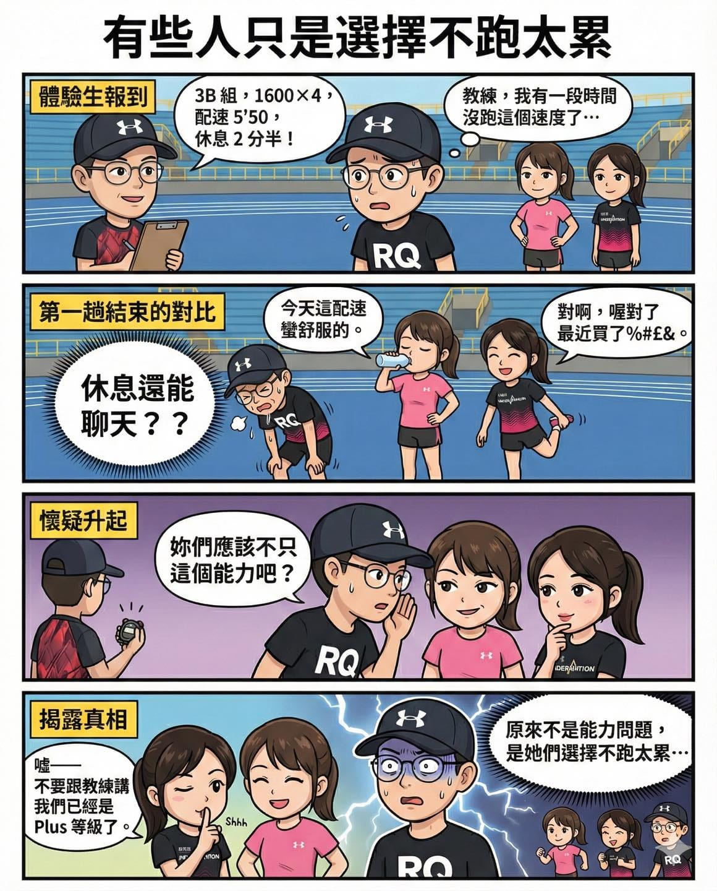

上次我去體驗 Hank 教練的動見跑班。

大家動作超熟練，熱身、技術操作一氣呵成，完全看得出來是長期團練的默契。分組後，我被分到 3B 組：

1600m × 4\
配速 5’50” /km\
趟休 2 分半。

老實說，我已經一段時間沒碰這種速度的間歇了，於是很誠實地跟教練報備。

教練很乾脆：「那你跑三趟就好。」

成交。

結果同組清一色都是女生。

第一趟結束，我在調呼吸，她們在聊天。

第二趟結束，我在思考人生，她們還是在聊天。

我腦袋只剩一個問號：

「休息時間還能閒話家常？？」

第三趟跑完，我忍不住問她們：

「妳們能力應該不只這樣吧？」

她們對看一眼，小聲說：

「噓，不要跟教練講，我們已經是 Plus 等級了。」

我瞬間懂了。

原來她們是刻意留在這組，沒有要升級。只是想跑在一個舒服、可控、可以聊天的強度啊！

沒問題，我絕對不會跟 Hank 教練說的。\
（我只是把故事變成漫畫而已 xDDDD）

已經很久沒參加實體跑班了，動見跑班的氛圍真的很舒服。教練對每個人的狀況都掌握得很細，強度安排也很有層次。

最後老話一句——

想開始跑步，直接找一團交通方便的跑班，報名費付下去，你就會開始動起來。

有團隊，有節奏，有人看著你進步，比自己亂跑有效率太多。

跑步這件事，先進場就贏一半。
