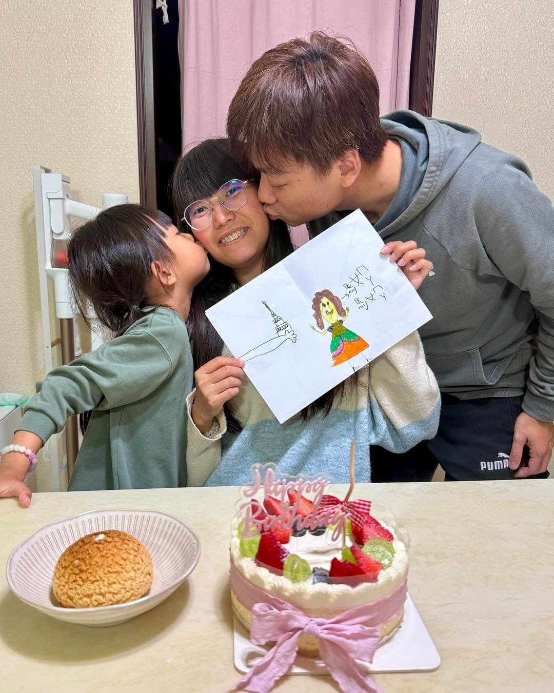

曾幾何時，我對各種節日都很有意見。

為什麼要拜拜？為什麼要送巧克力？為什麼要送禮？

總覺得這都是（古時候）商人搞出來的，跟我無關。

但是，現在的我，每個節日都過。

情人節要過、母親節要過，連桐桐養的魚滿月，也會找一天慶祝。

開始知道，在這一成不變的生活中，總是有些日子值得被記住，應該要去準備，哪怕只是一個簡單的小小儀式。

今天是桐媽媽生日。

買了她喜歡的蛋糕，一家人黏在一起。

幸福 \<3
