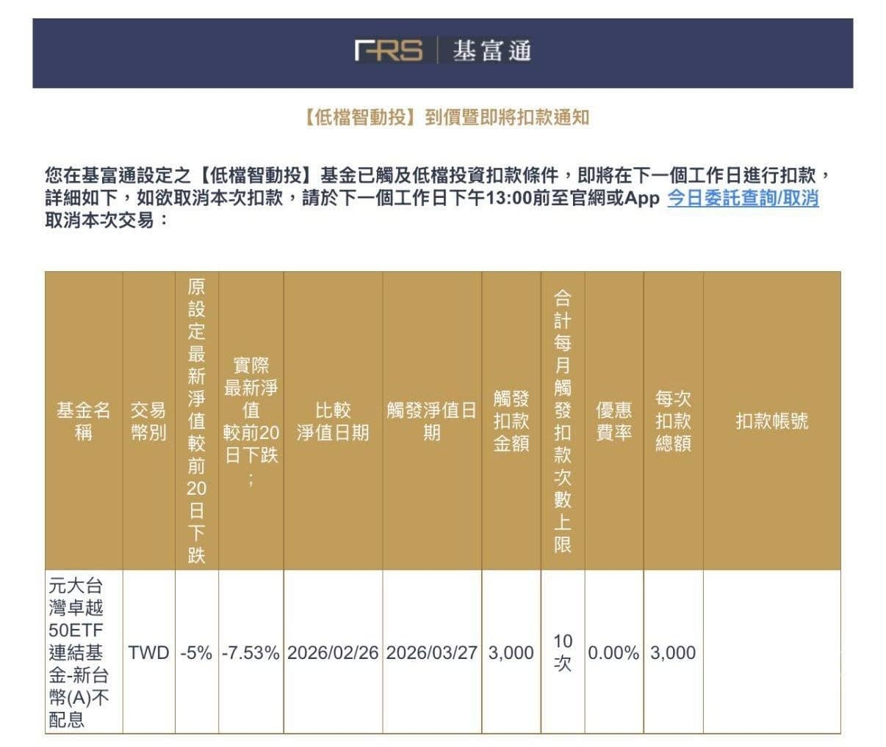

今天收到低檔智慧投資通知，才發現台股已經跌了一大段。

但老實說，我完全沒感覺。

最近真的排太滿了！

產品開發全速推進之餘，還跑去幼兒園當志工，各種節日過好過滿。

市場的波動，直接變成背景音樂。

自從轉職變成「大盤市值仔」之後，投資這件事就交給系統自動執行。

被動投資長期年化大約 8–10%，逢低加碼，論文早就講爛了，剩下就是紀律。

然後慢慢發現，人生的 KPI 變了。

開始在想的，不是怎麼多賺一點，而是怎麼穩穩地活得夠久。

能健康跑 20 年，你就已經贏過 99% 的投資人。

長期主義的終點，其實是你的身體。
