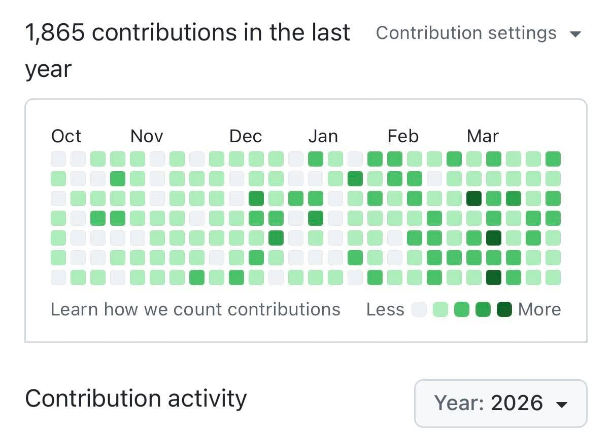

老實說，我自己都有點被嚇到。

從週年慶開始到現在，這段時間做的東西，如果放在以前，大概是三個月的進度。

而且這些不包含其他工程師開發的內容！

全都是我一個人，加上二月新加入的同事 Claude Code，完成的。

是我變強了嗎？

其實不是，是整個開發節奏，變了。

以前寫產品，最慢的地方是「寫程式」。

現在最慢的地方，是「誰要負責這次更新上正式」。（我每次人工審核都看超久…

這三週做的事情很多，但換一個角度看，其實都在做同一件事：

👉 把跑者每天會遇到的麻煩，一個一個拆掉。

排行榜不夠用？

那就做自訂區間、分組篩選，甚至可以用次數來排。

通知太多看不完？

直接做一個完整頁面，讓你一次看完所有訊息。

訂閱付款容易出錯？

所有會出問題的地方，一個一個補起來。

想要更聰明的訓練建議？

國峰老師的 AI 教練，已經上線了。

同時，RQ 正在往一個很明確的方向走。

從一個「跑步工具」，慢慢變成一個完整的訓練系統：有數據、有人、有結構，也開始有 AI。

以前，你用 RQ，是為了看更多數據。

接下來，我希望你用 RQ，是為了變強。
