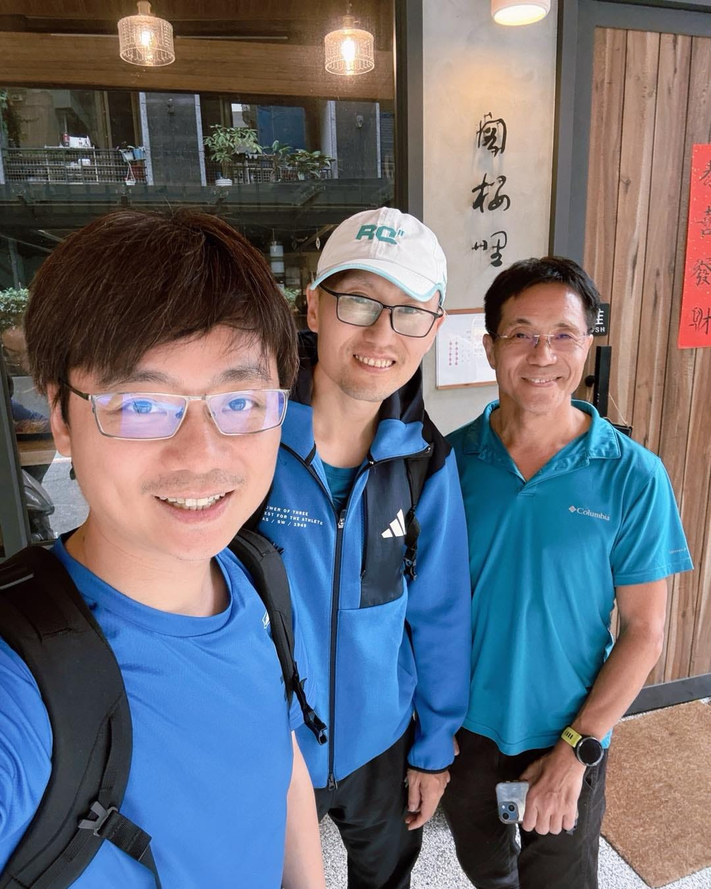

這趟，直接刷新我對「競爭壁壘」的理解。

今天來跟資訊圈大前輩 aka 配速之神高大哥取經，聊 AI 代理人的實務經驗。

結果聊到一半，我整個人嚇到！

他身為軟體公司的老闆，但他做了一件很反直覺的事，把 Source Code 原始程式碼直接交給客戶。

我當下真的忍不住問：

「這樣你的優勢不就直接被看光了？」

他很淡定地說：

「這樣我們才會被逼著一直進步。」

做了十年 RQ，我聽到這句話是真的驚呆了。

因為我也曾經很怕被抄、很怕被看穿，但到後來才慢慢體會到——

你真正該怕的，是自己停下來。

好久沒進城了。

但今天這一課，很值得。
