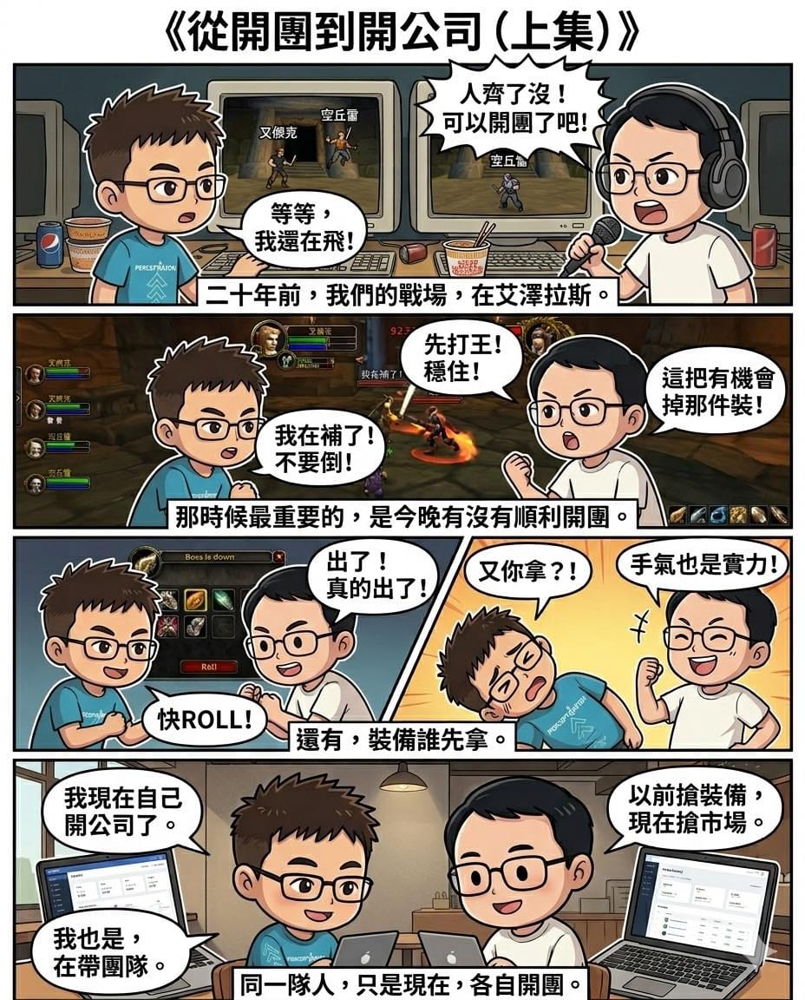

二十年前，我們在艾澤拉斯開團。

現在，我們在現實世界開公司。

那時候最重要的，是今晚人齊了沒、BOSS 能不能過。

現在最重要的，是產品能不能做出來、團隊能不能繼續走下去。

同一群人，只是戰場換了。

這位，是我當年一起打魔獸的戰友「空丘雷」。

以前我們在副本裡分工合作，有人扛傷害、有人補血、有人負責輸出。

一場打不好，就再來一次。

十年後再次見面，變成在聊各自的公司、產品與決策。

他一句我一句，講的都是「公司怎麼活下去」。

特別是疫情那幾年。

以前搶的是裝備；現在搶的是市場。

以前帶的是副本團，現在帶的是公司團隊。

突然發現，當年那些一起熬夜開團的人，

很多都已經在現實世界裡，變成獨當一面的隊長了。

而他的轉變，其實跟我還蠻相似的。

（[下集待續](/blog/fb-1453616180112935/)）
