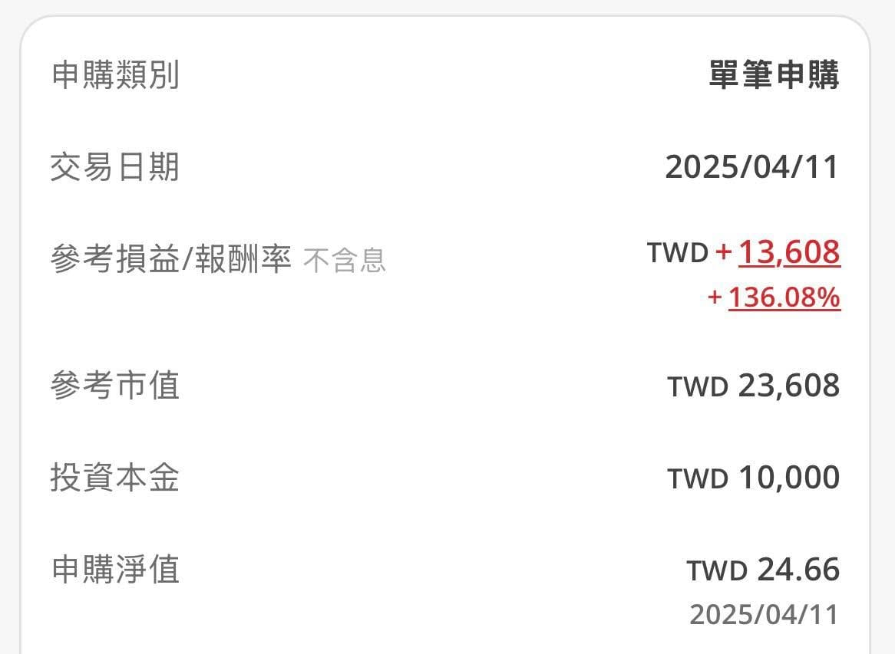

去年關稅戰大跌的時候，很多人看到下殺就開始恐慌賣出。

而我腦袋第一個念頭卻是：

「哇，0050 打折了！」🤣

問題是，我平常每個月固定投入 0050，而且我們家早就安排好 5 月要出國玩。

娛樂預備金是禁區，完全不能動。

最後只好開始東拼西湊。

翻抽屜、看帳戶、研究哪裡還有沒被老婆發現的錢（誤）。

好不容易才擠出一萬元加碼。

那時候我還一直到處跟家人說：

「這種等級的大跌其實很難得，有閒錢真的很值得加碼啊！」

結果大家看我的眼神，大概跟看邪教差不多。

一年後。

這一萬塊默默變成了兩萬多。

雖然現在回頭看，還是會忍不住想：

「如果當時有一百萬就好了……」

沒錯，投資最大的限制，就是你的本金。😂

所以與其每天幻想神操作，不如努力把本業做好。

畢竟能持續投入的能力，才是真正能拉開差距的東西。

跑步也是。\
育兒也是。\
人生大概都一樣。

穩穩累積，等待機會來的時候。

（然後下次崩盤時，我應該還是會先找看看哪裡能再湊一萬塊 🤣）
