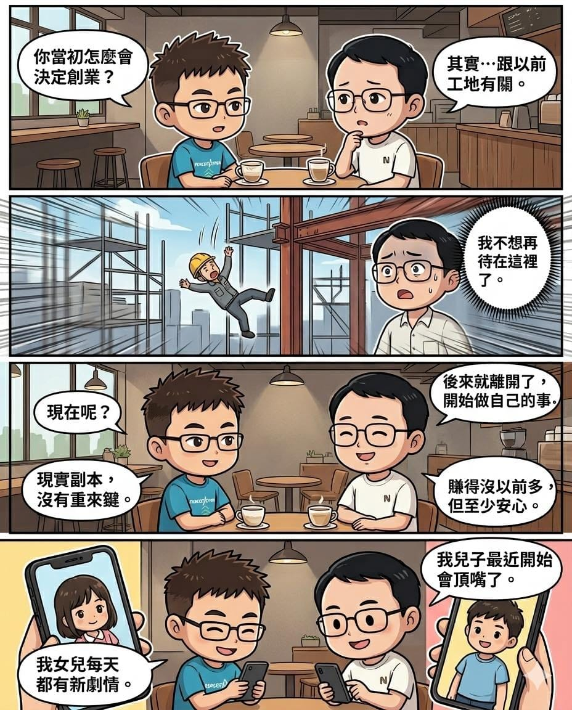

[接上集](/blog/fb-1452805726860647/)。

那天聊到一半，我問他：

「你當初怎麼會想創業？」

他沉默了一下。

然後開始講起以前在工地的日子。

有一次，他在工地親眼看見一場意外。

那一刻他突然意識到：

遊戲裡滅團，可以重來。\
角色倒了，可以復活。\
但現實人生，沒有重來鍵。

那之後，他離開了原本的工作，開始做自己的事。

他笑著跟我說：

「現在其實沒以前賺得多啦。」

但我發現，他講這句話的時候，表情反而比以前輕鬆很多。

因為現在的他，可以自己決定時間、決定方向、決定想過的人生。

後來我們聊著聊著，話題又默默從公司，變成了小孩。

突然發現，二十年前一起熬夜開團的人，現在都在分享育兒心得。

以前研究的是天賦配點；現在研究的是小孩情緒。

以前怕隊友倒；現在怕孩子生病。

人生真的很像 MMORPG。

每個階段，都有新的主線任務。

而我們，

只是從艾澤拉斯畢業了而已。
