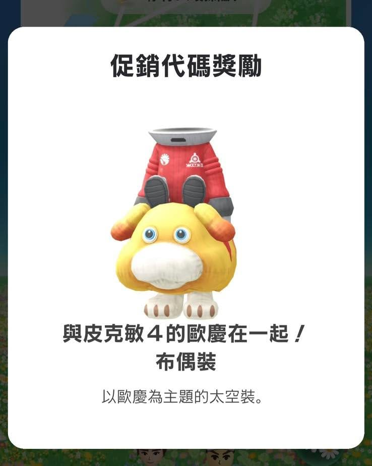

我才剛買 Switch 2，拍完桐爸開箱沒多久，我老婆就立刻丟了一個任務給我。

「皮克敏 4 的歐慶（那隻狗）造型免費領。」

免費。\
皮克敏。\
造型。

這三個關鍵字一出現，我就知道有事要做了。

條件是要先體驗《皮克敏 4》，還得收集到 1500 能量才能領造型。

我原本還很有自信地想：

「這種活動，應該半小時就結束了吧？」

結果——

我斷斷續續玩了兩天。

兩天後，我終於成功拿到這套歐慶太空裝布偶裝。

也順便第一次認真理解皮克敏的世界觀。

原來這是一款看起來超可愛，實際上卻會讓中年爸爸開始思考：

怎麼分配資源、怎麼安排隊伍、怎麼提高效率。

以及——

「什麼才是真正的慣老闆。」（誤

任天堂真的很懂。

免費造型只是入口，真正可怕的是你開始對皮克敏產生感情之後。

現在問題來了。

我要刷卡買《皮克敏 4》了嗎？
