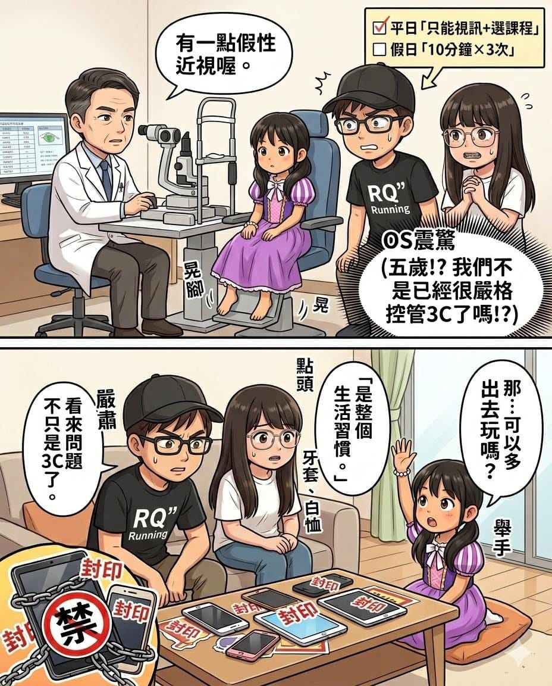

醫生一講完，我腦中直接開始 debug。

平日讓桐桐跟家人視訊，還有英文視訊課程，假日螢幕自由 10 分鐘 × 3 次。

3C 已經控到不能再控了。

那問題在哪？

回家後，我立刻查了一輪資料，整理出三個最關鍵的點，覺得一定要跟大家分享。

1️⃣ 每日戶外自然光 2 小時

平日其實沒什麼問題。

學校有活動時間、下課也會跑來跑去，基本上都有動到。

但假日就…

我們通常會安排一天出門，\
另外一天，很常直接宅在家。

一整天幾乎都是「室內全日模式」。

這個落差，比我原本想的還大很多。

2️⃣ 近看 30 分鐘要看遠

這一點，完全命中。

桐桐超愛畫畫，也很愛看故事書。

一開始都好好的坐著，

過一陣子就會變成：

越畫越近、越看越低，最後整個人快貼上去。

而且一坐下去，很容易就是一個小時起跳。

雖然沒有 3C，但眼睛一樣在高強度運作。

3️⃣ 晚上睡覺後燈全關

這點直接中招。

桐桐睡覺一定要開燈。

而且不是一盞，是很多盞。

床頭一個、牆邊一個、還有一個裝飾用的。

整個房間，有一種「夜間展場」的感覺。

我以前真的覺得這沒差，現在回頭看，影響其實是最長時間的那一段

最後我們也沒有再多限制什麼。

只是把生活調整回來：

✔ 假日宅在家那天，也想辦法補戶外時間\
✔ 畫畫跟看書，設一個「提醒停下來」的鬧鐘\
✔ 夜燈只留一盞，睡著後關掉

桐桐聽完之後，很認真地問：

「那我可以多出去玩嗎？」

嗯，這是要考驗我們的體力啊😅
