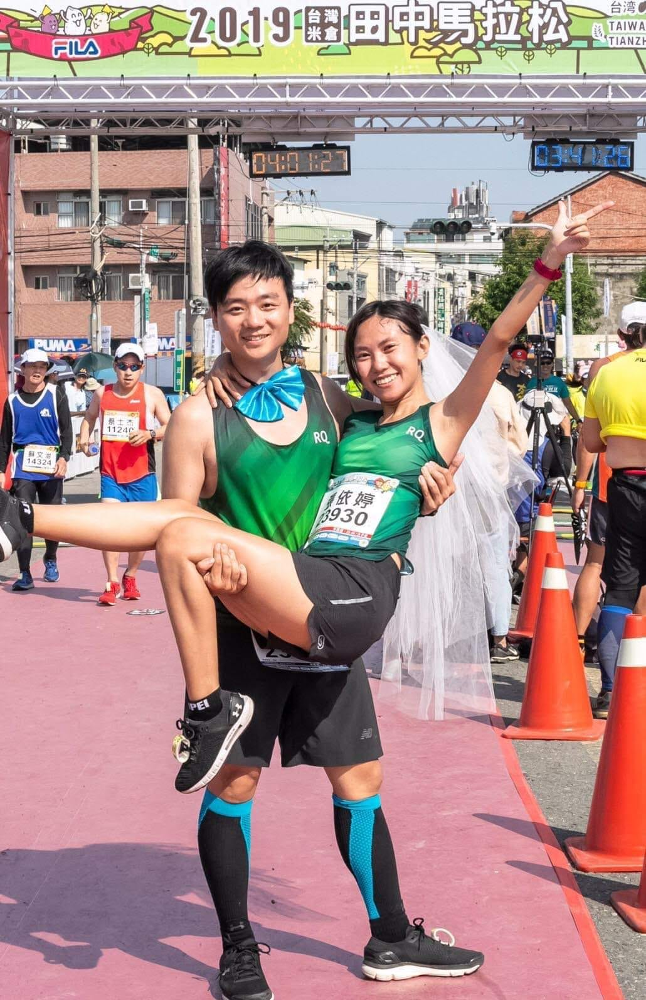

2019 年，結婚前幾個月，我老婆戴著頭紗，我們倆一起跑完了那場田中馬。

當時我們都還不知道，她肚子裡已經有桐桐了，是後來才發現的。

田中馬我連續跑了五年。台灣這麼多場馬拉松，田中的補給和鎮民的熱情一直是我心裡的第一名：整個小鎮的人站在路邊幫你加油、把吃的往你手裡塞，跑起來不像比賽，像回家。

所以這次 RQ 跟田中馬官方一起做了一件我覺得很浪漫的事：把你平常練出來的 RQ 跑力，換算成「田中馬力」。

數據是冷的，但它記錄的每一公里都是熱的。你練的每一趟課表，其實都在為某一場對你有意義的比賽存錢。
