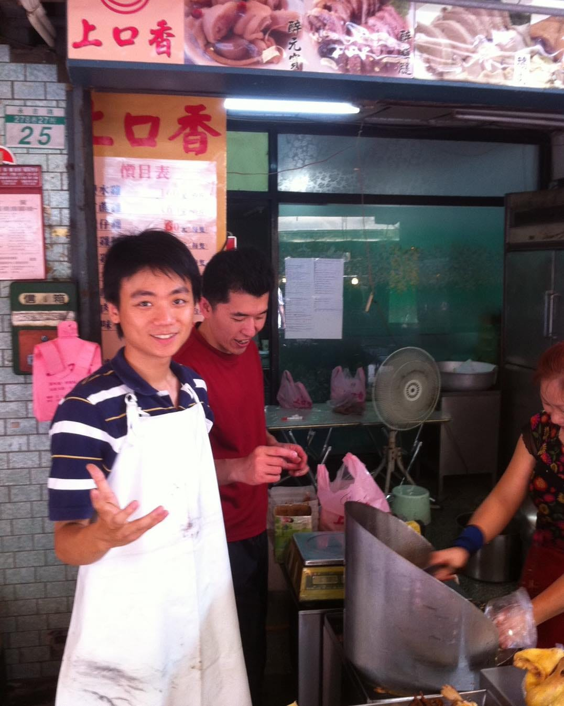

以前的我，每到端午節都要早起去攤位上賣雞。

那時候岳母還很擔心，桐媽真的跟我結婚以後，是不是每個假日都得跟著進菜市場幫忙剁雞，難過到晚上會默默掉眼淚。

老實說，我看爸媽每天都這麼辛苦，也是打從心底不想接我爸媽的攤位，一心只想往外跑。

結果一晃 20 年，我跑去念資工、自己創業開公司，現在天天看著 AI 把我的工作一個一個收掉.....

突然覺得，當年那把剁雞刀，搞不好才是最難被 AI 取代的鐵飯碗。

早知道我就乖乖留下來學接班了 (遠目
