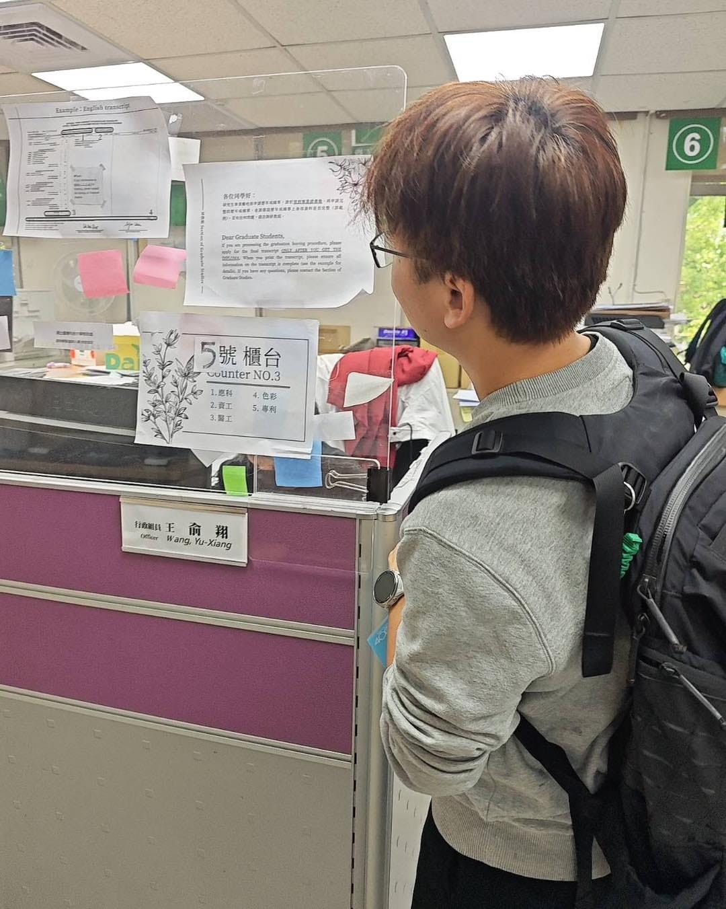

實在很不好意思講，但眼尖的你應該發現了，我已經一個多月沒寫研究生筆記。前陣子一連串的「事件」，讓我終於下了這個決定，也算是替重返臺科大資工博士班，劃下一個句點。

起因是今年 AI 發展實在太快，過年期間買了 Claude Code，開發速度真的大幅提升，有 24 小時不休息的「工程師」陪我一起討論架構、寫新功能、找 BUG，而且越來越懂我們專案在做什麼，真的越用越快、越用越爽。

再來是連續四週開車去臺科大的路上，都親眼目睹車禍。我單程就要開一個多小時，這四週看下來，真的是個大警惕。

第三件事，是在實驗室會議上，指導教授說他想在 2 年內退休。以我現在還要顧事業的狀態，要趕在教授退休前畢業，幾乎不可能。

剛好隔週的 Seminar 邀請了一位講師，課後提問相談甚歡，我還直接開車載他從臺科大回新竹。路上我們交換了很多創業血淚史，他也教我怎麼更深入地應用 AI。他自己也是從博士班休學創業，他認為現在是很難得的風口，我們應該好好把握這機會，把想做的事情好好做完。

最後，發生了一個「大烏龍」事件，讓我忐忑不安了一個多星期，以為自己剩下的人生可能沒我想像中這麼多。

隔天，我立刻去學校辦了休學。

當初跟夥伴徐國峰說的時候，他其實早就知道，我跑去念博士多少會拖到事業。但他還是支持我去圓這個夢。聽到我要休學，他反而要我先想清楚，還提醒我把時間留一點給自己跟家人，別整個人都埋進工作裡。結果有了 AI，我的工作時間反而不減反增，這個平衡我還在學。

我想把時間，花在我真正熱愛的事情上。

RQ 跑力 的待辦清單上還躺著五百多條任務。我想一條一條，把它們好好做完。

啊，別誤會！我身體非常健康，我可是要看著台股破十萬點呢！（遠目
