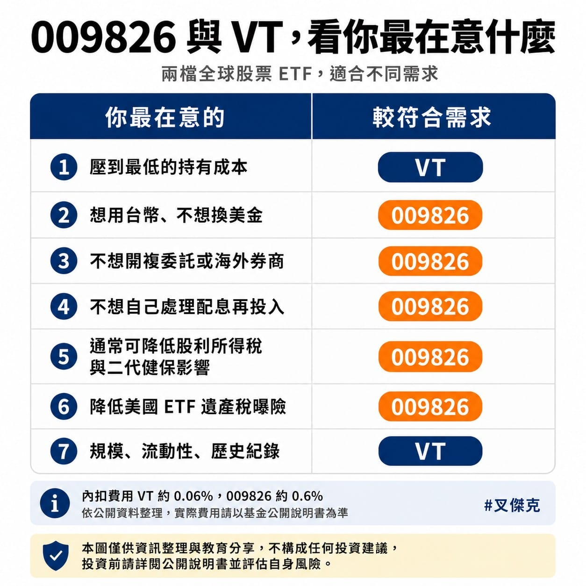

上個月我發過一句話：「到底這支會不會是台股 VT 呢？讓我們看下去～」

答案出來了。

貝萊德（BlackRock）的 009826，7 月 15 號開始募集，市場都在叫它「台版 VT」。講白話，就是用新台幣、在你原本的台股券商，一筆買進全世界近 40 國、上千檔股票。

不用戰「009826 跟 VT 誰比較好」，我比較想講的是，這兩個其實是給不同需求的人用的工具，還有我自己打算怎麼做。

先講最現實的，成本。

VT 的內扣費用大約 0.06%，009826 是經理費 0.45% 加保管費 0.15%，再加上指數授權費這些其他費用，初期內扣總成本大約 0.6 ~ 0.7%。

數字看起來都很小，但拉長到幾十年的複利就有感。

假設你放 500 萬、長期不動，VT 一年內扣大約 3,000 元，009826 大約 30,000 多元，一年差超過 3 萬。金額愈大、放愈久，這個差距愈明顯。

那為什麼還是有人會選 009826？因為它解決的是「麻煩」跟「稅」。

買 VT 要開複委託或海外券商、要換美金，配息進來還得自己再買回去；而且你是直接持有美國的 ETF，未來牽涉到美國遺產稅、海外資產這些事，處理起來比較複雜。

009826 是台幣直接買、不用換匯、不用開海外戶。它是累積型、不配息，股息自動滾進淨值，你不用自己再投入；而且以現在的制度，因為不配息，你也不會為了這檔的配息去多繳一筆股利所得稅或二代健保補充保費。資產留在台灣，之後要繼承也單純。

不過它畢竟是全新的。

VT 規模超過 500 億美元、成立很久、買賣價差極小、流動性全球數一數二；009826 才剛要募集，規模、成交量、買賣價差，全部都還要等上市後才看得準。有指數投資的前輩就提醒，新 ETF 要看業者願不願意認真造市，規模太小甚至有被清算的風險，以前台股真的發生過。追蹤指數的誤差控制好不好，也得跑個幾年才知道。

講我自己。

我不會賣掉 VT，也不會賣掉 0050。已經在裡面的就放著，繼續長期持有。

我打算改的，只是「新的錢往哪裡流」。之後要新增投入全球的部分，預計改放 009826，讓全球配置慢慢往上拉，同時不再增加我直接持有美國 ETF 的部位。

舊的不動，新的轉向。這樣我不必為了換工具去實現損益、多繳一筆稅，又能慢慢把方向調成我想要的。

所以對我來說，這從來不是「哪一檔比較強」的問題。

工具會一直推陳出新，但真正決定結果的，是你的資產配置，還有你能不能放著不要亂動。

我之前寫過那個南部親戚，答應好 0050 要放到退休，結果才兩個月就忍不住全賣了，就算今天大跌後的價格來看，距離他賣掉的 80 元也差異巨大。最難的從來不是選標的，是不動。這跟跑步一樣，課表寫得再漂亮，能不能照紀律執行，才是真正的分水嶺。

照例提醒，這不是投資建議，稅務細節也因人而異、我不是專家，只是分享我自己怎麼想、怎麼做。每個人的資金、年期、能扛的風險都不一樣嘿！
