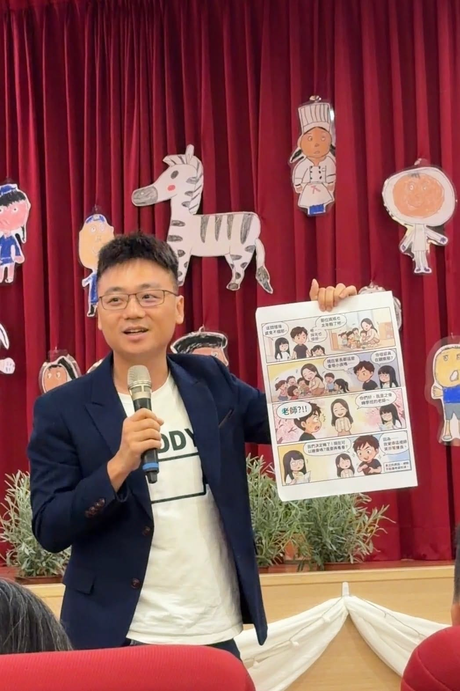

今天去參加桐桐的幼兒園畢業典禮，被老師邀請當家長代表上台分享感想。

為了這短短 3 分鐘，我準備了好長一段時間，前前後後改了 30 多個版本。最後的講稿也分享給各位，有需要的家長可以先存起來，以後自己上台時拿來用喔！（誤

園長、各位老師、各位家長，還有最可愛的畢業生們，大家好。

我是 ○○ 班桐桐的爸爸，孩子們都叫我「桐爸」。

（舉起漫畫，停一下讓大家看。）

我平常會把女兒的日常畫成漫畫，在網路上分享，叫做《桐爸日記》。今天本來想分享一整本，不過老師只給我三分鐘，所以只有帶一張來。

（笑一下）

這張畫的是兩年多前，我們第一次來 ○○ 參觀。那天看的是 ○○ 班，陽光灑進教室，○○ 老師蹲在地上，很自然地陪第一次見面的桐桐玩。我跟桐媽對看一眼，當下心裡只有一句話：

「就是這裡了。」

為了讓桐桐來 ○○，我們甚至搬離精心打造的小窩，搬到學校附近，堪稱現代版的「桐爸三遷」。

現在回頭看，這是我們全家做過最值得的決定。

我最喜歡 ○○ 的一點，是老師總願意帶孩子走出校園、踏入社區。

這兩年只要有戶外踏查，我跟桐媽幾乎每次都請假來當志工。一開始只是想多陪自己的孩子，後來才發現，更開心的是能夠和全班孩子一起成長。

在 ○○，我看到老師不是硬把知識塞給孩子，而是打造各種角落，讓他們探索世界、主動學習。

不過你要是問桐桐，○○ 最棒的是什麼……答案一定是──

「○○ 老師區。」

（笑，停一下。）

啊，我才恍然大悟，真正讓孩子愛上學的，不是教室，也不是玩具，而是老師。

所以今天我想說的，不只是祝福畢業，更想說一聲謝謝。

謝謝園長、○○ 老師、○○ 老師，謝謝每一位老師，讓孩子每天都期待上學，也讓我們家長放心把孩子交給你們。

最後，恭喜所有畢業生，這是你們人生第一次畢業。希望你們帶著在 ○○ 學會的勇敢、善良，還有對這世界的好奇心，快快樂樂迎接小學新生活。

我知道你們很捨不得。

其實，我比你們更捨不得。

不過我們還有最後一個月，我跟桐桐保證，一定乖乖上課、不亂請假，珍惜每一天。老師們，最後這一個月，再拜託你們了。

謝謝大家。\
講完還有一位同學的媽媽跑來問我 IG，真是不好意思，身為老人的我主要都還在用臉書啦！
