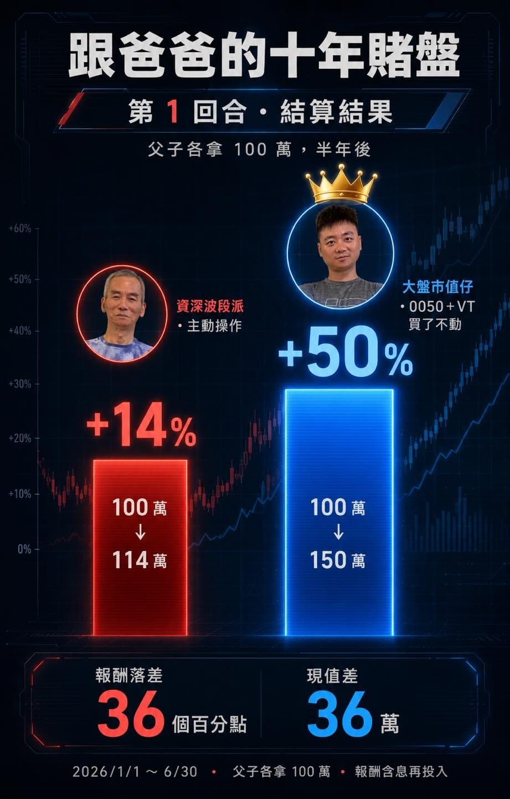

先講結果：

爸爸 aka 資深波段派：+14%，本金 100 萬 → 114 萬

兒子 aka 大盤市值仔：+50%，本金 100 萬 → 150 萬

落差 36 個百分點，現值差了 36 萬。

這局剛好遇到台股史上最強大爆發。最有意思的是：主動操作的人，輸給了什麼都沒做的人。

我沒看盤、沒研究任何一檔股票，時間拿來忙我自己的事、陪桐桐到處玩。我爸剛好相反，他是個老練的波段派、盤感比我強太多，這半年他卻選擇滿手現金、按兵不動，只有忍不住做了幾次波段，半年下來 +14%。

說真的，半年 +14% 也已經是贏過不少人了，但這半年的大盤實在太猛，老手的盤感，還是追不上「整個市場」。

我問他怎麼看，他的原話貼上來：

「這半年的行情跟以前不一樣，以前都有波段性，這次是直接往上衝，應該是 AI 的浪潮。我們這種年紀比較保守，不敢下手。」

「現在的股票，真的看不懂。」

你看，他不是沒在動，他做了幾次也有賺。只是這種 AI 直直噴的行情，連多年盤感的老手都直說「跟以前不一樣」。在這種市場，狠狠贏的反而是「無腦抱著整個市場、什麼都不判斷」的人。

主動 vs 被動，第一局，被動暫時大勝。

但我一點都不敢得意。

運氣好贏在遇到這半年直直噴。我們比的是十年，這才第一局。

我問我爸第二局有沒有信心，他只淡淡說「能平手就好」。嘴上謙虛，但我太清楚，他正在等下一個波段，他看好下半年的生技股。老手的可怕，從來不是他賺多少，是他永遠在等下一個更好的時機。

其實這場約定，我就是想做個實驗，到底真實世界的大盤仔十年來能贏過多少次主動操作者呢？

第二局，12/31 結算，2027 元旦正式公開，我爸已經放話要追平了，就讓我們看下去！
